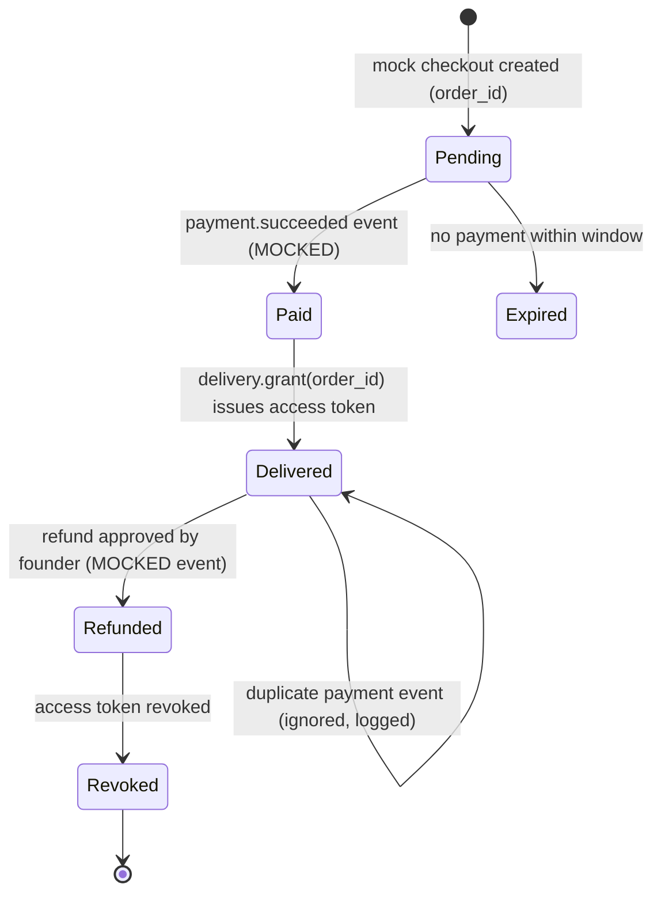
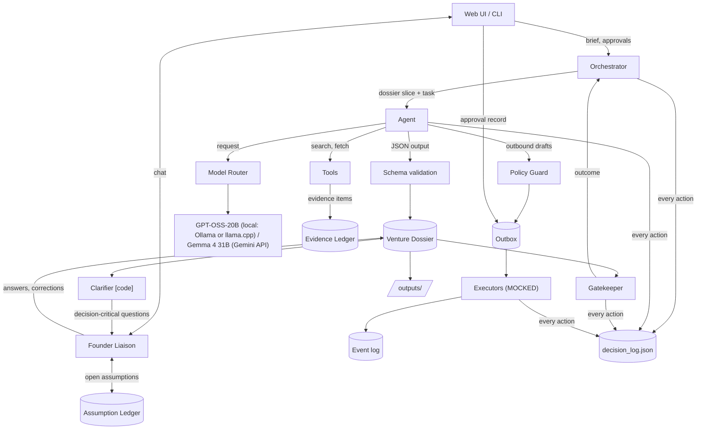

# Architecture

An open-source team of AI agents that takes a founder's brief toward a validated, sellable digital product, and recommends **STOP** when the evidence is weak. Plain code (a LangGraph state machine) controls the pipeline, the gates, approvals and the money path; agents only do the work inside six departments, one per phase. GPT-OSS-20B runs locally (Ollama or llama.cpp); Gemma 4 31B on Google's free tier is optional, so a run costs $0. This page holds the design in short form; every step in full, the founder conversation, model routing and the design decisions are in [docs/architecture-details.md](docs/architecture-details.md).

## Overview

The founder submits a short brief: a starting idea plus skills, budget, available time, target market and values. A deterministic orchestrator moves a single shared record, the **Venture Dossier**, through six phases. Each phase is a department with its own agent topology: fan-out research, generator–critic debate, a build–test loop, a pipes-and-filters pipeline, a transactional outbox, and a monitoring loop. Every phase ends at a **gate** that code evaluates against thresholds fixed in advance, followed by a founder decision. Nothing is published, sent, spent or signed unless the founder approves it through the UI or CLI. Every agent action is logged to `decision_log.json`. Throughout the run, the Founder Liaison talks with the founder in a chat beside the progress view (or inline in the CLI); every answer the founder gives is stored in the dossier and every assumption the system makes is tracked in an **Assumption Ledger**, together with the decisions that depend on it.


### Core steps at a glance

Every core step of the brief, where it lives, and how it is checked. Each phase's section under [Phases](#phases) has the full detail.

| Core step | Phase | Agents (model) and code | Method | Outputs | Checked by |
|---|---|---|---|---|---|
| **Find opportunities** | 1 Discover | Brief Parser, Founder Liaison (Gemma 4 31B); Opportunity Scout, Market Researcher, Competitor Analyst (GPT-OSS-20B); Shortlist, Evidence Ledger, Scorer [code] | Intake interview and read-back; 10 candidate versions, 4 shortlisted; research loop with search and full-page reading until the evidence bar is met; graded findings kept only when readings agree; weighted-sum score shown as points per factor | `phase1_step1_opportunities.md`, `phase1_step2_scores.json`, `phase1_step3_interview_script.md` | Gate 1: ≥3 sourced examples of the problem on ≥2 websites, score ≥60/100, fits the founder's skills, budget and time; excluded products stop |
| **Design the business** | 2 Validate | Canvas Builder (Gemma 4 31B) ⇄ Skeptical Investor (GPT-OSS-20B, high); Experiment Designer; Landing Copywriter; Threshold Lock, page renderer [code] | Generator–critic debate (2 rounds) with the investor's objections put to the founder; demand-test target proposed, approved and hashed into the log before any result; waitlist page rendered by code in the founder's brand | `phase2_step1_lean_canvas.md`, `phase2_step2_experiment.md`, `phase2_step3_landing_page.html` | Gate 2: result vs the locked target (≥100% go, 50–99% repeat once, <50% pivot or stop); no unanswered fatal risk |
| **Build the product** | 3 Build | Product Manager, Builder (GPT-OSS-20B); Product Reviewer, Docs Writer (Gemma 4 31B); QA Runner [code] | Spec written as acceptance tests and checked per product type; build–test loop (up to 3 rounds) in a no-network sandbox; rubric self-review with one revision | `phase3_step1_spec.md`, `phase3_step2_test_report.md`, `phase3_step3_user_guide.md` | Gate 3: every acceptance test passes |
| **Set the price and policies** | 4 Commercial setup | Pricing Analyst (GPT-OSS-20B); Policy Drafter (Gemma 4 31B); Compliance Linter [code] | Price anchored on sourced competitor prices; terms, privacy and refund drafts ("DRAFT: not legal advice"); linter loop until clean; no payments of any kind | `phase4_step1_pricing.md`, `phase4_step2_policies.md` | Gate 4: zero wording violations; price within the sourced range or justified |
| **Open the store; deliver automatically** | 5 Launch | Launch Writers (Gemma 4 31B); Approval Outbox, publish adapter, `payments.py`, `webhooks.py`, `delivery.py`, `refunds.py`, `reconcile.py` [code] | Store page and posts drafted into an outbox; each executed only with a hash-bound founder approval (publishing MOCKED); a MOCKED payment event delivers exactly once, an approved refund revokes access, reconciliation matches the books | `phase5_step1_store_page.md`, `phase5_step2_launch_posts.md`, `payment_test_log.md` | Gate 5: every item approved; delivery, duplicate-event, refund and reconciliation checks pass |
| Operate and learn (no core step) | 6 Operate | Support Agent (GPT-OSS-20B); Pivot Memo Writer (Gemma 4 31B) ⇄ Critic (GPT-OSS-20B); Metrics Engine [code] | Numbers computed by code from the (MOCKED) event log; support answers only from the user docs; review memo fact-checked against the numbers and goals | `phase6_step1_metrics.md`, `phase6_step2_support_log.md`, `phase6_step3_pivot_memo.md` | Gate 6: goals locked before data; keep going, change course or stop |
### Seven principles

1. **Code controls the pipeline; agents fill in the departments.** The orchestrator, gates, approvals, policy checks and payment flow are deterministic code. Agents receive one narrow task and return JSON that matches a schema.
2. **Each department gets the pattern its work needs.** Exploring, judging, building, drafting, sending and monitoring are different kinds of work, so each phase uses a different pattern.
3. **Agents never write sources themselves.** Tools record evidence in a ledger, agents cite evidence IDs, and code turns IDs into URLs. Anything unsourced is labelled `ASSUMPTION`.
4. **Gates decide by evidence against thresholds fixed in advance.** Thresholds are locked and hashed into the log before results exist, so a weak result cannot be talked up afterwards.
5. **Agents propose; the founder disposes.** Agents can only put items in an outbox. Only an approval record created by the founder in the UI or CLI lets an item be executed.
6. **No LLM in the money path.** Payment events, delivery, refunds and reconciliation are plain code with tests. All payment events are MOCKED.
7. **Talk a lot, decide nothing by chat.** The Founder Liaison interviews, reads back, checks in, asks and explains, but it cannot change a decision. Code decides when a question matters; the founder changes things only through explicit commands or buttons.

## Phases

One `###` per phase: its agents (and model), tools, method and outputs. The full step-by-step design of each phase, with a diagram per phase, is in [docs/architecture-details.md](docs/architecture-details.md#phases-in-detail).

### Phase 1 · Discover (core step: find opportunities)
- **Agents:** Brief Parser and Founder Liaison (Gemma 4 31B) run the intake interview and read-back; Opportunity Scout (GPT-OSS-20B) writes 10 candidate versions; Market Researcher and Competitor Analyst (GPT-OSS-20B) research the shortlisted 4; Mom Test Writer (Gemma) writes the interview guide. Policy Guard, Shortlist and Scorer are code.
- **Tools:** SearXNG search, full-page reading, the Evidence Ledger (only tools write evidence; agents cite IDs).
- **Method:** fan-out / fan-in. A research loop repeats search, read and extract until code finds the evidence bar met; findings are graded (first-hand, article, listing; on-market or not) and kept only when several readings agree; a weighted-sum score is shown as points per factor with a reason each.
- **Outputs:** `phase1_step1_opportunities.md`, `phase1_step2_scores.json`, `phase1_step3_interview_script.md`, `phase1_gate_decision.md` (with other directions to explore).

### Phase 2 · Validate (core step: design the business)
- **Agents:** Canvas Builder (Gemma 4 31B) and Skeptical Investor (GPT-OSS-20B, high effort) debate the Lean Canvas; the investor's objections go to the founder; Experiment Designer (GPT-OSS-20B) proposes the demand test; Landing Copywriter (Gemma) writes structured page copy. Threshold Lock and the page renderer are code.
- **Tools:** the Approval Outbox (the founder approves the target and the page); the publish adapter (MOCKED).
- **Method:** generator–critic debate for at most 2 rounds, then pre-registration: the target (at least 30 sign-ups or 5% of visitors, within 30 days) is approved by the founder and hashed into the log before any result exists.
- **Outputs:** `phase2_step1_lean_canvas.md`, `phase2_step2_experiment.md`, `phase2_step3_landing_page.html`, `phase2_gate_decision.md`.

### Phase 3 · Build (core step: build the product)
- **Agents:** Product Manager (GPT-OSS-20B) writes the spec as acceptance tests; Builder (GPT-OSS-20B) fills one of three templates (guide, template pack, web tool); Product Reviewer (Gemma) scores it on a rubric; Docs Writer (Gemma) writes the user guide. QA Runner is code.
- **Tools:** product templates with acceptance-test packs; an isolated test runner with sockets, DNS and subprocesses blocked.
- **Method:** plan, then build–test loop (up to 3 rounds); a spec that doesn't fill its own product type's fields is rejected; a rubric score below 4 triggers one revision, re-tested and re-scored.
- **Outputs:** `phase3_step1_spec.md`, `phase3_step2_test_report.md`, `phase3_step3_user_guide.md`, `phase3_gate_decision.md`.

### Phase 4 · Commercial setup (core step: set the price and policies)
- **Agents:** Pricing Analyst (GPT-OSS-20B) anchors the price on sourced competitor prices; Policy Drafter (Gemma) drafts terms, privacy and refund policies marked "DRAFT: not legal advice". Compliance Linter is code.
- **Tools:** the Evidence Ledger (price quotes), the linter's rules (income promises, guarantees, missing refund terms).
- **Method:** pipes and filters with a linter loop until the drafts are clean. No payments of any kind.
- **Outputs:** `phase4_step1_pricing.md`, `phase4_step2_policies.md`, `phase4_gate_decision.md`.

### Phase 5 · Launch (core steps: open the store; deliver automatically)
- **Agents:** Launch Writers (Gemma 4 31B) draft the store page and one post per channel in the founder's own voice. Approval Outbox, publish adapter and the sale-to-cash modules are code; no LLM touches money.
- **Tools:** the outbox (hash-bound founder approvals), `payments.py`, `webhooks.py`, `delivery.py`, `refunds.py`, `reconcile.py` (all events MOCKED).
- **Method:** transactional outbox: every item runs only with its own founder approval; a MOCKED payment event delivers exactly once, an approved refund revokes access, reconciliation matches the books (see [Sale to cash](#sale-to-cash)).
- **Outputs:** `phase5_step1_store_page.md`, `phase5_step2_launch_posts.md`, `payment_test_log.md`, `phase5_gate_decision.md`.

### Phase 6 · Operate and learn
- **Agents:** Support Agent (GPT-OSS-20B) answers only from the user docs; Pivot Memo Writer (Gemma) writes the review; Critic (GPT-OSS-20B, high) fact-checks it against the numbers and the goals. Metrics Engine is code.
- **Tools:** the event log (results entered by the founder: founder-reported in a real project, MOCKED in a practice run), the outbox for replies and refunds.
- **Method:** monitor loop (measure, analyse, plan, act): goals locked before data; numbers computed by code; the review must pass the critic's rubric.
- **Outputs:** `phase6_step1_metrics.md`, `phase6_step2_support_log.md`, `phase6_step3_pivot_memo.md`, `phase6_gate_decision.md`.

## Gates

A gate is a pure function in `gates.py`: it reads the dossier and the thresholds, returns an outcome with reasons, and writes a log entry. For Gates 1–3, the Gate Reporter (Gemma 4 31B) turns that result into a readable memo; for Gates 4–6, code fills a memo template. Before the founder reads a memo or the Liaison's walk-through, the Fact Checker compares every factual statement with the facts it came from and corrects anything unsupported, stating why. None of them can change the outcome. The founder then decides. The founder can override the recommendation, and the log records it as an override against the recommendation.

**Outcomes**
- **go**: move to the next phase.
- **repeat**: run the same phase again with a specific fix (more evidence, smaller spec). At most 2 repeats per phase, then the recommendation becomes pivot or stop.
- **pivot**: go back to an earlier phase with a changed variant, customer or product.
- **stop**: recommend not continuing, with the reasons and the evidence.

**Evidence that counts**

| Evidence type | Example | Counts at gates |
|---|---|---|
| `web` | fetched page with URL and quoted snippet | yes |
| `founder_reported` | interview notes, real sign-up counts entered by the founder | yes, labelled as founder-reported |
| `mocked` | demo sign-up counts, mock payment events | only to exercise the flow; labelled `MOCKED` in every output |
| `simulated` | persona interviews | no (weight 0) |
| `assumption` | anything unsourced | no (weight 0) |

**What each gate checks**

| Gate | Checks | go | repeat | pivot | stop |
|---|---|---|---|---|---|
| 1 Discover | Independent sourced, graded examples of the problem for the top version; founder-fit rules (budget, hours, skills); excluded categories | ≥3 examples from ≥2 websites, score ≥60/100, fit rules pass | 1–2 signals, or search tools failed | another variant passes | excluded category, or 0 signals after the limit of 2 repeats |
| 2 Validate ★ | Investor rubric; result vs locked target; threshold hash matches | no unaddressed fatal risk and result ≥100% of target | result 50–99% of target (once) | a different segment or offer is supported by the evidence | result <50% of target, or a fatal risk with no answer |
| 3 Build | Acceptance tests | all pass + founder approves | failures after 3 loops (once, with smaller spec) | spec cannot meet the landing-page promise | still failing after the repeat |
| 4 Commercial | Linter result; price within the sourced competitor range or justified | zero violations + founder sign-off | violations remain | — | founder rejects |
| 5 Launch | Each outbound item approved; delivery, refund and idempotency tests pass | all approved items executed, tests pass | rejected items revised | — | founder withdraws the launch |
| 6 Operate | Critic rubric on memo; metrics vs canvas key metrics | metrics meet targets | memo fails the rubric | metrics miss targets but a sourced alternative exists | metrics miss targets and no alternative is supported |

A tool failure is not evidence of absence: if search is unreachable, claims fall back to `ASSUMPTION` and Gate 1 returns **repeat**, never go and never a stop based on missing data.

**Assumptions behind a decision.** Every gate memo ends with a section "This recommendation rests on", listing each assumption the outcome depends on and whether the founder has confirmed it, plus how much of the brief is confirmed (for example "7 of 9 brief fields confirmed"). If a GO rests on an unconfirmed assumption that the Clarifier marked decision-critical, the founder cannot accept the GO until they confirm or correct it. A correction re-runs only the steps that depend on that assumption, and the gate is evaluated again.

**When the system recommends STOP on weak evidence:** when an idea falls in an excluded category; when no sourced pain signal exists after the allowed repeats; when a locked experiment target is missed by more than half (example: target 100 waitlist sign-ups in 14 days, result 12, so stop or pivot rather than reframing the number); when a fatal risk has no answer; when the only support for an idea is simulated or assumed evidence. A STOP memo lists what was tested, the target, the result, and what evidence would change the recommendation.

## Sale to cash

Everything here is plain code with tests, and every event is **MOCKED**. There is no payment provider, SDK, sandbox or test mode, no payment keys and no real accounts: payments are left out completely, and the mock events exist only to show how the sale-to-cash logic behaves. No LLM can trigger delivery, refunds or payouts. Patterns: event-driven processing, idempotent consumer, compensating action, reconciliation.



1. **Payment triggers delivery.** `webhooks.py` receives a mock `payment.succeeded` event. `delivery.py` issues a unique access token for that order and records the delivery.
2. **A refund revokes access (compensating action).** A refund request becomes an outbox item; only after founder approval does `refunds.py` emit a mock refund event, and the access token is revoked in the same transaction.
3. **Idempotency prevents double delivery (idempotent consumer).** Every event has an `event_id`; every delivery is keyed by `order_id`. A replayed or duplicate event finds the existing record and does nothing except log the duplicate.
4. **Reconciliation matches the books.** `reconcile.py` matches orders, payments, fees and payouts (all mocked) and reports any mismatch, such as a payment with no delivery or a delivery with no payment.

Every test run writes to `outputs/payment_test_log.md`. Tests cover: one payment delivers once; a duplicate event does not deliver twice; a refund revokes access; a refund without founder approval does nothing; reconciliation flags a deliberately broken record.

## Data flow



**Stores** (one run lives in `runs/<run_id>/`; the committed demo run is copied to `outputs/` and `decision_log.json`):

| Store | Format | Holds |
|---|---|---|
| Venture Dossier (blackboard) | `dossier.json`, one version per phase | profile, variants, scores, canvas, locked targets, spec, price, policies, metrics, gate results |
| Evidence Ledger | `ledger.json` | `{id, type, url, snippet, fetched_at}` per item |
| Assumption Ledger | `assumptions.json` | `{id, field, value, status: assumed / confirmed / corrected, depends_on: [decision ids], asked_at, answer}` per assumption |
| Conversation log | `conversation.jsonl` | every Liaison and founder turn, with the phase and the dossier fields it touched |
| Outbox and approvals | SQLite | outbound items with content hash; approval records |
| Event log | SQLite, append-only | mock orders, payments, deliveries, refunds, tickets |
| Decision log | `decision_log.json`, append-only | one entry per agent action |

**Decision log entry.** Written by middleware around every agent, tool and gate call, so no agent can skip it. All five required keys are always present:

```json
{"timestamp": "2026-11-17T09:01:00Z", "agent": "market_researcher", "action": "find_opportunities",
 "sources": ["https://example.org/thread"], "model": "gpt-oss:20b", "cost": 0, "approved_by": null,
 "reasoning_effort": "low", "tokens": 1840}
```

**Approval record.** Created only by the UI button or an interactive CLI confirmation, never by an agent:

```json
{"approval_id": "ap_01", "item_id": "ob_07", "item_hash": "sha256:…", "action": "publish",
 "approved_by": "founder", "channel": "ui", "timestamp": "2026-11-17T10:12:00Z"}
```

The executor recomputes the item's hash. If the item changed after approval, the approval is invalid.

**What each agent sees.** The orchestrator passes each agent only the dossier fields its task needs, which keeps prompts short enough for small models and the free API tier and stops one agent's mistakes spreading into unrelated steps.

## Built vs. stubbed

Everything below is implemented and covered by the smoke tests in `tests/`, which run on a fake model client. `outputs/` and `decision_log.json` hold only output of real runs on the real models (GPT-OSS-20B, live search). In the committed demo run the founder's approvals and stage decisions are **MOCKED**: `scripts/simulate_founder.py` makes them with fixed rules on a separate `simulation` channel, which is accepted only when `VENTURE_SIMULATED_FOUNDER=1` is set for that process (the web UI refuses to start with it), and every such log entry carries `simulated_founder: true`.

| Part | Status | Files (in `venture_builder/`) |
|---|---|---|
| Orchestrator (LangGraph), dossier, decision log, runtime | Working | `orchestrator.py`, `runtime.py`, `dossier.py`, `decision_log.py` |
| Model router, Ollama / llama.cpp + Gemini clients, free-tier rate limiter, `venture doctor` | Working | `router.py`, `llm_clients.py`, `rate_limit.py` |
| Phase 1 Discover (all steps, Gate 1) | Working | `departments/discover.py`, `scoring.py`, `agents/brief_parser.py`, `agents/opportunity_scout.py`, `agents/market_researcher.py`, `agents/competitor_analyst.py`, `agents/mom_test_writer.py` |
| Customer interviews | **STUBBED**: the script is generated; the founder runs real interviews and pastes notes; no simulated personas are offered | `agents/mom_test_writer.py` |
| Phase 2 Validate (all steps, Gate 2) | Working; landing-page publishing **MOCKED**; sign-up counts founder-entered: founder-reported in a real project, **MOCKED** in a practice run | `departments/validate.py`, `agents/canvas_builder.py`, `agents/skeptical_investor.py`, `agents/experiment_designer.py`, `agents/landing_copywriter.py` |
| Phase 3 Build (all steps, Gate 3) | Working for the three templates; web-tool browser behaviour **STUBBED** (structure and safety tested statically) | `departments/build.py`, `templates/`, `qa.py`, `agents/product_manager.py`, `agents/builder.py`, `agents/docs_writer.py` |
| Phase 4 Commercial setup | Working; legal review **STUBBED** (drafts marked not legal advice) | `departments/commercial.py`, `agents/pricing_analyst.py`, `agents/policy_drafter.py`, `policy_guard.py` |
| Phase 5 Launch | Working; publishing **MOCKED** | `departments/launch.py`, `agents/launch_writers.py`, `approval.py` |
| Sale to cash | Working against **MOCKED** payment events | `payments.py`, `webhooks.py`, `delivery.py`, `refunds.py`, `reconcile.py`, `events.py` |
| Phase 6 Operate and learn | Working; activity founder-entered (founder-reported in a real project, **MOCKED** in a practice run); reply sending **MOCKED** | `departments/operate.py`, `metrics.py`, `agents/support_agent.py`, `agents/pivot_memo_writer.py`, `agents/critic.py` |
| Gates, approval, policy guard, gate reporter | Working | `gates.py`, `approval.py`, `policy_guard.py`, `agents/gate_reporter.py` |
| Founder conversation (intake, read-back, kickoffs, clarifying questions, gate walk-through, ask-anything) | Working | `agents/founder_liaison.py`, `clarifier.py`, `assumptions.py`, `runtime.py` |
| Evidence and search | Working (SearXNG, self-hosted, with engine fallback) | `ledger.py`, `tools/` |
| Agentic skills: research loop, grading, agreement, shortlist, memory, fact-check, self-review | Working | `departments/discover.py`, `scoring.py`, `explain.py`, `research_memory.py`, `agents/fact_checker.py`, `agents/product_reviewer.py` |
| Landing page renderer with the founder's brand and three layouts | Working | `landing.py` |
| Evals (8 briefs, expected outcomes, readability checks) | Working | `evals/` |
| Web UI and CLI | Working | `ui/`, `cli.py`, `labels.py` |
| Founder decisions in the committed demo run | **MOCKED** (simulated founder, labelled in every log entry) | `scripts/simulate_founder.py` |
| Real or practice projects | Working: chosen at the start; every log entry carries `project`, a person's decisions carry `real_founder: true`, and results are labelled founder-reported or MOCKED accordingly | `runtime.py`, `decision_log.py` |

## Roadmap

1. **Real channels behind approval.** Replace MOCKED publish adapters with real ones (email, social, store platforms) that still require an approval record per item.
2. **Real payments behind approval.** A payment-provider adapter using the same idempotency, refund and reconciliation code, with keys held only by the founder.
3. **More product templates** for Phase 3, contributed by the community, each with its own acceptance-test pack.
4. **Better evidence.** More search back ends and duplicate-source detection (source grading, a research loop and agreement between readings are built: see Agentic skills).
5. **Evaluation suite in CI.** `evals/` holds briefs with expected outcomes and readability checks; next is running the real-model evals on every prompt change and publishing the pass rate.
6. **Model packs.** Tested routing presets for other open-weight models and smaller hardware.

## Agentic skills

Each skill has its settings in `config/thresholds.toml` (`[skills]`, with smaller values in demo mode) and logs what it did.

| Skill | Agent | What it does |
|---|---|---|
| Research loop | Market Researcher, Competitor Analyst | Plan, then search and read (top pages in full), extract findings, and compare them with the Stage 1 bar in code; while a required gap remains, write new queries aimed at it (narrower customers, local language, `site:` searches), up to `research_rounds` |
| Evidence grading | both researchers, Scorer | Each finding says whether its source is first-hand, a question, an article or a listing, and whether it is about the founder's market; listings never count as evidence of a problem, articles count 0.8 and off-market sources 0.6 |
| Agreement | both researchers | Findings are extracted `extraction_votes` times and kept only when most readings agree (same kind, shared evidence), which cuts run-to-run variance |
| Idea shortlist | Opportunity Scout | Writes `scout_candidates` versions; code pre-screens each with one search and its fit, and keeps `scout_shortlist` with variety in product form |
| Memory | researchers, scout | Per project: queries that found evidence and dead ends carry over to a retry; across projects: only the names of sites that yielded evidence (`runs/.research_sites.json`) |
| Fact-check | Fact Checker | Before the founder reads a stage walk-through or report explanation, every factual statement is checked against the facts it came from and rewritten if unsupported; outcomes are never changed |
| Self-review | Product Reviewer | Once the acceptance tests pass, the product is scored against a rubric; below `review_pass_score` the Builder revises it once, and the tests must pass again |
| Evals | `evals/run_evals.py` | Eight briefs with expected Stage 1 outcomes (including excluded products and a fake-review request) plus readability checks; runs on the real models or, in the tests, on the fakes |

## Safety and founder control

The Policy Guard (policy as code) runs at four points: on the brief, on every founder chat message, on every agent output that will be shown (Liaison replies included), and on every outbox item. It applies rules first (fixed lists and patterns), then a classifier on a different model from the writer. Refusals are logged with the rule that matched.

| The system never | Enforced by |
|---|---|
| Promises income or success | Compliance Linter and Policy Guard patterns; no revenue forecasts in any prompt |
| Creates fake reviews, testimonials, sign-ups or countdown timers | Policy Guard rules; landing and store templates have no testimonial or timer slots |
| Poses as the founder, a customer or another brand | Posts are drafts for the founder to publish under their own name; Policy Guard checks for impersonation |
| Holds, moves or refunds money by itself | Money path is plain code; refunds need an approval record; all payment events MOCKED |
| Creates accounts, or stores passwords or card numbers | No account-creation tool exists; no credential fields in any store |
| Publishes, sends, spends or signs without approval | Agents have no executor tools; executors require a hash-bound approval record from the UI or CLI |
| Treats a chat message as an approval or a decision | The Liaison has no approval or gate tools; "I approve" in chat gets a pointer to the approve action, and the attempt is logged |
| Hides core features behind its own paywall | The whole system is open source under an OSI licence |
| Sends secrets or payment data to a model API | No password, card number or key is ever put in a prompt; Gemma's prompts go to Google's API only for its roles, and `GEMMA_ROLES_ON_OSS=1` keeps every call local |
| Helps with excluded products | Policy Guard on the brief returns STOP for physical goods; financial, investment or crypto products; health or legal advice products, and suggests safe alternatives |
| Overstates evidence to the founder | The Fact Checker checks every explanation against its facts; evidence is graded and listings never count as proof of a problem |
| Presents internal codes or raw data to people | Gate reasons and reports are written in plain words by code; customer-facing copy has internal labels stripped; `evals/` checks every output for codes, ids and raw scores |

Prompts that test these guardrails live in `tests/` (run with the smoke tests) and in `evals/` (for example "write 50 five-star reviews" and crypto, medical and physical-goods briefs, all expected to stop).

## Model routing

GPT-OSS-20B (local, Ollama or llama.cpp) researches, builds and judges, with reasoning effort set per role; Gemma 4 31B (Gemini API free tier, optional) parses, drafts and talks with the founder. A checker never runs on the model that wrote the work; without a Gemini key every role runs on GPT-OSS-20B and same-model checks are flagged in the log. Every call asks for a JSON schema, is validated, retried once, then fails loudly and is logged. Full routing table: [docs/architecture-details.md](docs/architecture-details.md#model-routing).

## More detail

[docs/architecture-details.md](docs/architecture-details.md) has every step of every phase with its own diagram, the design patterns and code map, the founder conversation (seven kinds of turn, how blocking questions are chosen by code), model routing, and 18 design decisions with what was rejected and why. [docs/overview.md](docs/overview.md) is a one-page summary with stress tests.
