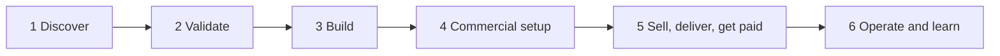

# Architecture

## Overview

TBD.

## Phases

### Phase 1: Discover

TBD. Detail: [docs/phases/phase1.md](docs/phases/phase1.md).

### Phase 2: Validate

TBD. Detail: [docs/phases/phase2.md](docs/phases/phase2.md).

### Phase 3: Build

TBD. Detail: [docs/phases/phase3.md](docs/phases/phase3.md).

### Phase 4: Commercial setup

TBD. Detail: [docs/phases/phase4.md](docs/phases/phase4.md).

### Phase 5: Sell, deliver and get paid

TBD. Detail: [docs/phases/phase5.md](docs/phases/phase5.md).

### Phase 6: Operate and learn

TBD. Detail: [docs/phases/phase6.md](docs/phases/phase6.md).

## Gates

TBD.

## Sale to cash

TBD.

## Data flow

TBD.

## Built vs. stubbed

Nothing is built yet; every phase is **STUBBED**.

## Roadmap

TBD.
