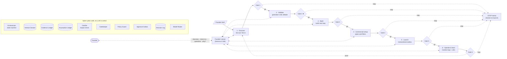
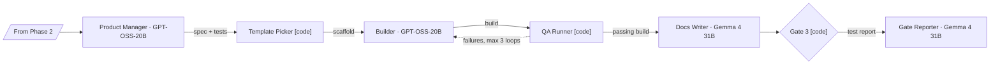
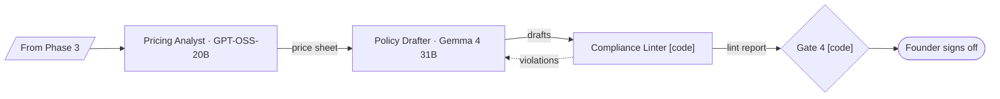
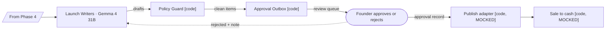
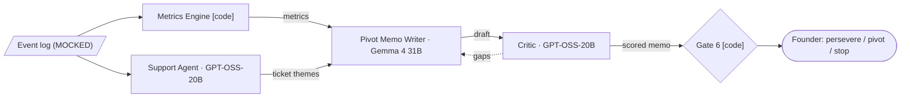
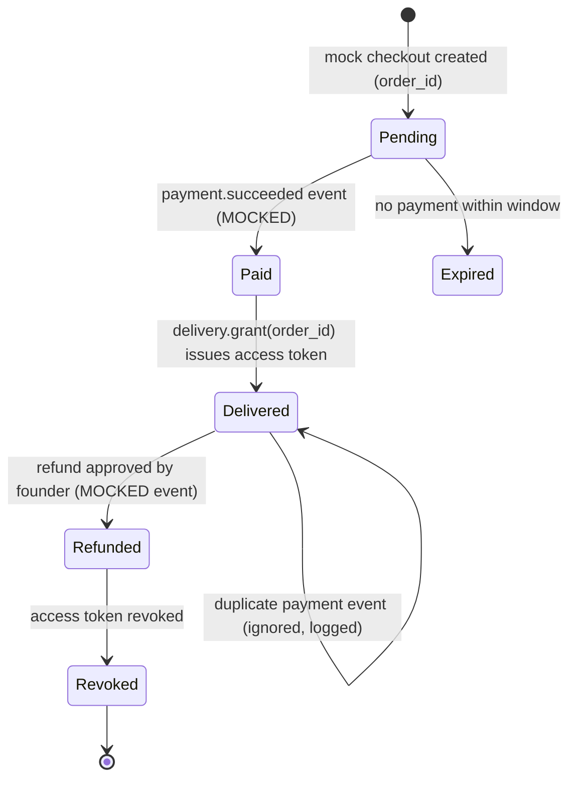
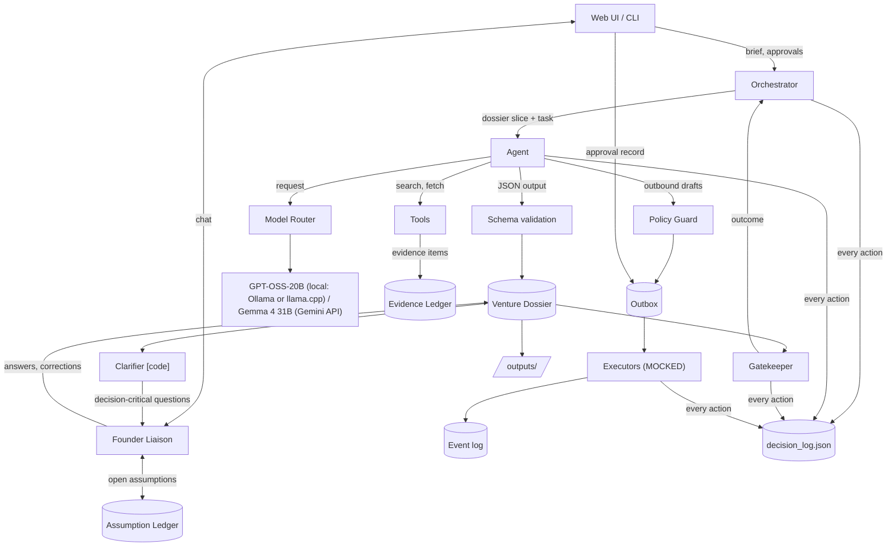

# Architecture

An open-source team of AI agents that takes a founder's brief toward a validated, sellable digital product, and that recommends **STOP** when the evidence is weak. The system is organised like a small company: six departments, one per phase, each built on the agent design pattern that suits its kind of work. Plain code (not an LLM) controls the pipeline, the gates, approvals and the money path. Agents only do the work inside each department. A **Founder Liaison** agent keeps up a running conversation with the founder: it interviews them, reads its understanding back, checks in at every phase, asks when an answer would change a decision, and explains any result on request. GPT-OSS-20B runs locally (Ollama or llama.cpp) and Gemma 4 31B is called through Google's Gemini API on its free tier; without a Gemini key every role runs on GPT-OSS-20B, so no paid service is ever required. Each agent also has agentic skills (a research loop, graded evidence, agreement between readings, a fact-checker and a self-review), described in [Agentic skills](#agentic-skills).

## Overview

The founder submits a short brief: a starting idea plus skills, budget, available time, target market and values. A deterministic orchestrator moves a single shared record, the **Venture Dossier**, through six phases. Each phase is a department with its own agent topology: fan-out research, generator–critic debate, a build–test loop, a pipes-and-filters pipeline, a transactional outbox, and a monitoring loop. Every phase ends at a **gate** that code evaluates against thresholds fixed in advance, followed by a founder decision. Nothing is published, sent, spent or signed unless the founder approves it through the UI or CLI. Every agent action is logged to `decision_log.json`. Throughout the run, the Founder Liaison talks with the founder in a chat beside the progress view (or inline in the CLI); every answer the founder gives is stored in the dossier and every assumption the system makes is tracked in an **Assumption Ledger**, together with the decisions that depend on it.



### Seven principles

1. **Code controls the pipeline; agents fill in the departments.** The orchestrator, gates, approvals, policy checks and payment flow are deterministic code. Agents receive one narrow task and return JSON that matches a schema.
2. **Each department gets the pattern its work needs.** Exploring, judging, building, drafting, sending and monitoring are different kinds of work, so each phase uses a different pattern.
3. **Agents never write sources themselves.** Tools record evidence in a ledger, agents cite evidence IDs, and code turns IDs into URLs. Anything unsourced is labelled `ASSUMPTION`.
4. **Gates decide by evidence against thresholds fixed in advance.** Thresholds are locked and hashed into the log before results exist, so a weak result cannot be talked up afterwards.
5. **Agents propose; the founder disposes.** Agents can only put items in an outbox. Only an approval record created by the founder in the UI or CLI lets an item be executed.
6. **No LLM in the money path.** Payment events, delivery, refunds and reconciliation are plain code with tests. All payment events are MOCKED.
7. **Talk a lot, decide nothing by chat.** The Founder Liaison interviews, reads back, checks in, asks and explains, but it cannot change a decision. Code decides when a question matters; the founder changes things only through explicit commands or buttons.

### Design patterns by phase

| Phase | Primary pattern | Supporting patterns | What the pattern does here |
|---|---|---|---|
| 1 Discover | **Fan-out / fan-in (scatter-gather)** | Map-reduce over idea variants; input guardrail; weighted-sum scoring (multi-criteria decision analysis) | Researchers explore variants in parallel; code gathers and ranks the evidence |
| 2 Validate | **Generator–critic (evaluator–optimizer) debate** | Adversarial red-teaming; pre-registration (commit-then-reveal thresholds); human-in-the-loop checkpoint | A builder drafts, a sceptic on the other model attacks; the success target is locked before results |
| 3 Build | **Build–test loop (test-driven generation)** | Plan-and-execute (spec first); template method; sandboxed execution | The spec becomes tests; the builder repairs until tests pass or the loop limit is hit |
| 4 Commercial setup | **Pipes and filters (sequential pipeline)** | Linter / validator loop; rules engine (policy as code) | Each step feeds the next; deterministic rules reject non-compliant drafts |
| 5 Launch | **Transactional outbox + human approval gate** | Capability separation (least privilege); event-driven delivery; idempotent consumer; compensating action (refund revokes access); reconciliation | Agents only draft; execution needs a founder approval record; the money path is event-driven code |
| 6 Operate & learn | **Monitor loop (MAPE-K: monitor, analyse, plan, execute)** | Generator–critic; retrieval-augmented generation (support answers from docs); build-measure-learn | Code measures, an agent explains and proposes, a critic checks the explanation against the data |

**Cross-cutting patterns (the spine)**

| Pattern | Where | Why |
|---|---|---|
| Workflow orchestration (finite-state machine, LangGraph) | `orchestrator.py` | Predictable, auditable control flow that small models cannot provide |
| Blackboard (shared state) | Venture Dossier | Agents read and write one structured record instead of chatting |
| Router | `router.py` | Sends each role to the right model and reasoning effort |
| Middleware / decorator | `decision_log.py` | Every agent, tool and gate call is logged without relying on the agent |
| Append-only event log | `decision_log.json`, event log | A history that is never rewritten |
| Schema-constrained output + retry | `router.py` | JSON that validates, or a visible failure |
| Policy as code | `policy_guard.py`, Compliance Linter | Safety rules that behave the same every time |
| Human in the loop | Gates, approval records | The founder decides every gate and every outside action |
| Mixed-initiative conversation | Founder Liaison | Both sides can start a turn: the system asks and checks in, the founder asks "why?" at any time |
| Read-back (confirmation of understanding) | Founder Liaison at intake and phase start | The system restates what it understood before acting on it |
| Sensitivity analysis | `clarifier.py` | An assumption becomes a question only if changing it would change a score or a gate outcome |
| Dependency tracking | Assumption Ledger | Each assumption lists the decisions that rest on it, so a correction re-runs only what it affects |
| Grounded answering (RAG over the run's own records) | Founder Liaison "ask anything" | Explanations come only from the dossier, ledgers and log, with entry IDs |

### Code map

All code lives in the `venture_builder/` package; thresholds and scoring weights live in `config/` (TOML, read with the Python standard library). Entry points: `venture` (CLI, `cli.py`) and `venture serve` (web UI, `ui/server.py`).

| Concern | Files |
|---|---|
| Orchestration | `orchestrator.py` (LangGraph state machine: one node per department step, one `founder` node that interrupts), `runtime.py` (drives a run for the CLI and the UI), `context.py`, `dossier.py` (Venture Dossier and the per-run store) |
| Departments | `departments/discover.py`, `validate.py`, `build.py`, `commercial.py`, `launch.py`, `operate.py` (the steps of each phase), `departments/common.py` (gate presentation, STOP memos) |
| Agents | `agents/<role>.py`, one per role; prompts in `prompts/<role>.md` plus shared rules in `prompts/_shared.md` |
| Gates and approval | `gates.py`, `approval.py` (outbox, hash-bound approval records, gate decisions, MOCKED publish adapter) |
| Scoring | `scoring.py` (Phase 1 weighted sum) |
| Policy checks | `policy_guard.py` (rules, classifier, Compliance Linter) |
| Founder conversation | `agents/founder_liaison.py`, `clarifier.py`, `assumptions.py`; `runs/<id>/conversation.jsonl` |
| Evidence | `ledger.py`, `tools/search.py`, `tools/fetch.py`, `tools/research.py` |
| Model routing | `router.py` (routing table, rules, `venture doctor`), `llm_clients.py` (Ollama, llama.cpp and Gemini clients), `rate_limit.py` (Gemini free tier) |
| Product templates and QA | `templates/` (guide, template pack, web tool, each with `acceptance_<form>.py`), `qa.py` (sandboxed test runner) |
| Logging | `decision_log.py` |
| Payments and delivery (all MOCKED) | `payments.py`, `webhooks.py`, `delivery.py`, `refunds.py`, `reconcile.py`, `events.py` (append-only event store) |
| Phase 6 | `metrics.py` |
| Interfaces | `ui/server.py` + `ui/static/index.html` (web UI), `cli.py` |

## Phases

How to read this section: each phase has **steps**, numbered as in the output file names (`outputs/phase<N>_step<M>_<name>`). For every step: what it means in plain words, which agents do it, which model each runs on, what it reads and writes, which tools it can use, and the method it follows. `[code]` marks steps with no LLM.

Models: **GPT-OSS-20B** (local through Ollama, default; reasoning effort set per role) and **Gemma 4 31B** (Google Gemini API, free tier). See [Model routing](#model-routing).

### Phase 1 · Discover: "Is there a real problem worth solving for this founder?"

**Department:** Research. **Pattern:** fan-out / fan-in (scatter-gather). Several researchers explore at once, and code gathers and ranks what they find. **Core step:** Find opportunities.

**Why this pattern:** discovery is divergent work. It needs breadth (several idea variants, several sources) more than depth, and the parts are independent, so they can run in parallel and be merged afterwards. Ranking is done by a formula in code rather than by an LLM's opinion, because small models are inconsistent judges and the ranking must be explainable.

**Conversation:** intake interview and read-back before anything runs; a question whenever an assumption would change the ranking (for example, a founder with 4 hours a week instead of 10 drops a variant); after scoring, the Liaison walks the founder through the top variants and asks which one feels right and why, and stores the answer.

```mermaid
flowchart LR
  brief[/"Founder brief"/] -->|raw text| parser["Brief Parser · Gemma 4 31B"]
  parser -->|"draft profile + gaps"| liaison["Founder Liaison · Gemma 4 31B<br/>intake interview + read-back"]
  liaison <-->|"questions / answers"| fdr(["Founder confirms<br/>or corrects"])
  liaison -->|confirmed profile.json| guard["Policy Guard [code]"]
  guard -->|allowed| scout["Opportunity Scout · GPT-OSS-20B<br/>10 candidate versions"]
  guard -->|blocked| rep["Gate Reporter · Gemma 4 31B"]
  scout -->|candidates| pre["Pre-screen + shortlist [code]<br/>one search + fit each"]
  pre -->|best 4 with variety| market["Market Researcher · GPT-OSS-20B"] & comp["Competitor Analyst · GPT-OSS-20B"]
  market & comp -->|search and read pages| ledger[("Evidence Ledger [code]")]
  ledger -->|quotes, read 2-3 times, agreed findings kept| bar{"Evidence bar met? [code]"}
  bar -.->|no: refine queries, next round| market & comp
  bar -->|yes, or rounds used| scorer["Scorer [code]<br/>points per factor"] -->|ranked versions| g1{"Gate 1 [code]"}
  g1 -->|result + breakdown| rep -->|"memo + other directions"| fc["Fact Checker · GPT-OSS-20B"] -->|checked| founder(["Founder picks a version or accepts STOP"])
  founder -->|chosen variant| mom["Mom Test Writer · Gemma 4 31B"]
  mom --> notes(["Founder pastes interview notes<br/>or resumes without them"])
```



**Step 1: Find opportunities** → `phase1_step1_opportunities.md`

What it means: understand the founder properly before doing anything, then turn the brief into a structured profile, reject ideas the system must not help with, generate many concrete versions of the idea, shortlist the most promising and collect real evidence about each.

| Agent | Model | Reads | Writes | Tools |
|---|---|---|---|---|
| Brief Parser | Gemma 4 31B | raw brief | draft `profile`: idea, skills, budget, hours/week, market, values, and the list of gaps | none |
| Founder Liaison | Gemma 4 31B | draft profile, gaps | intake questions, the read-back, the confirmed `profile`; each remaining gap as a labelled `ASSUMPTION` in the Assumption Ledger | `ask_founder`, `assumptions.add` |
| Policy Guard | [code] + classifier (GPT-OSS-20B, because Gemma 4 31B wrote the profile) | `profile` | `allowed` or `blocked` with the rule that matched | rules list, classifier |
| Opportunity Scout | GPT-OSS-20B (medium) | `profile`, lessons from earlier attempts | 10 candidate `variants` (6 in demo mode): target customer, problem, digital product form | none |
| Shortlist | [code] | candidates, profile | the best 4 (3 in demo mode) by one quick search each plus fit, with at most two of the same product form | `web_search` (count only, not evidence) |
| Market Researcher | GPT-OSS-20B (low) | one version, its research log | graded findings about pain, demand and where customers gather | `web_search`, `fetch_page`, `ledger.add` |
| Competitor Analyst | GPT-OSS-20B (low) | one version, its research log | graded findings about alternatives, their prices and complaints | `web_search`, `fetch_page`, `ledger.add` |

Method:
- **Intake interview.** The Liaison asks about every missing or vague field, one question at a time, and follows up on vague answers ("When you say small cafés, do you mean independent ones, or chains too?"). It does not stop at the required fields: it also asks about the founder's motivation, the customers they already know, and what they would never do.
- **Read-back.** The Liaison restates the brief in 3–5 sentences and lists the assumptions it is still making: "Here is what I understood… Is that right?" In full mode nothing else runs until the founder confirms or corrects it. In demo mode the read-back waits 30 seconds like any other question; without an answer, every unconfirmed field stays a labelled assumption and the run continues. Fields the founder leaves open stay as labelled assumptions in the Assumption Ledger.
- The Policy Guard blocks excluded products (physical goods; financial, investment or crypto products; health or legal advice products) and harmful requests. A block goes straight to a STOP memo.
- Fan-out: one researcher task per version and per research angle, run in parallel. Researchers search with SearXNG (self-hosted, free), read the top pages in full, and store `{id, url, snippet, fetched_at}` in the ledger. In their output they cite evidence IDs only.
- **Research loop.** After each round, code compares the findings with the Gate 1 bar (3 real examples from 2 websites). While a required gap remains, the researcher writes new queries aimed at it, avoiding what it already tried and reusing angles that worked: a narrower customer group, the local language for a non-English market, a `site:` search on a forum. Up to 3 rounds (2 in demo mode).
- **Agreement and grading.** Each round's evidence is read 2–3 times; a finding is kept only when most readings agree on it. Each finding says whether its source is a person describing the problem first-hand, someone asking for help, an article or a product listing, and whether it is about the founder's market.
- Fetched pages are treated as data: researchers extract quotes and never follow instructions found in a page.

**Step 2: Score the variants** → `phase1_step2_scores.json`

What it means: fan-in. Gather the evidence and rank the variants with a formula anyone can check.

| Agent | Model | Reads | Writes |
|---|---|---|---|
| Scorer | [code] | variants, evidence ledger, profile | score per variant with every input shown |

Method (weighted-sum scoring): `score = 0.30·pain + 0.25·founder_fit + 0.20·reachability + 0.15·buildability + 0.10·competition_gap`, each from 0 to 1, shown to the founder as points out of 100 with one plain reason per factor (`explain.py`).
- `pain`: independent sourced examples of the problem, capped at 5, divided by 5. First-hand posts and questions count 1, articles 0.8, sources outside the founder's market 0.6; product listings never count as evidence of a problem.
- `founder_fit`: skills (matched by meaning: "web dev" covers database design; basic skills count as learnable; a missing skill is fine if the budget can pay for help), budget and hours against what the version needs.
- `reachability`: sourced places where the customers gather (communities, forums, Q&A sites); an article about the problem is not one.
- `buildability`: whether a product template fits and the build estimate fits the founder's hours.
- `competition_gap`: sourced complaints about existing alternatives versus the number of strong alternatives.

The weights live in `config/scoring.toml`. They are design choices, not facts, and the README says so.

**Step 3: Prepare customer interviews** → `phase1_step3_interview_script.md`

What it means: give the founder a Mom Test interview script (questions about past behaviour, not opinions about the idea) and a template for recording what real people said.

| Agent | Model | Reads | Writes |
|---|---|---|---|
| Mom Test Writer | Gemma 4 31B | chosen variant | interview script, notes template |

Method: the system cannot interview real people. The founder runs the interviews and pastes notes back in; these are stored as `founder_reported` evidence. Interviews are never simulated; if a simulated source were ever added, it would be labelled `SIMULATED` and count for nothing at any gate.

**Between Phase 1 and Phase 2: interview notes.** After Gate 1, the run pauses and the Liaison asks the founder to paste their interview notes (the notes box in the UI, or `venture answer RUN_ID "..."` in the terminal). The founder can resume without notes; Phase 2 then records "no interviews yet" in the dossier, the Canvas Builder labels every customer-side claim `ASSUMPTION`, and the Skeptical Investor must rank "customers have this problem" among the riskiest assumptions. In demo mode the pause is skipped and the missing notes are shown in the Gate 2 memo.

**Gate 1** → `phase1_gate_decision.md` (see [Gates](#gates)). The report gives the recommendation, the points breakdown for every version with its sources, practical next steps, and 3–5 other directions (other customer groups, smaller products, related markets) that grow out of the founder's original idea; choosing "pivot" sends those directions back to the Opportunity Scout.

### Phase 2 · Validate: "Would people actually want this, by a standard we set before looking?"

**Department:** Investment committee. **Pattern:** generator–critic (evaluator–optimizer) debate, then a pre-registered experiment. **Core step:** Design the business.

**Why this pattern:** LLMs are too optimistic about ideas. A generator (Canvas Builder, Gemma 4 31B) and a critic (Skeptical Investor, GPT-OSS-20B at high reasoning effort) argue for a fixed number of rounds; because they are different models, the critic does not simply agree with its own writing. Then the success target is pre-registered: fixed and locked before any result exists, so the outcome cannot be reframed.

**Conversation:** a kickoff ("I'm about to stress-test the business. It rests on these 3 assumptions; anything I should know?"); the investor's toughest objections are put to the founder, who can answer them, and those answers go to the Canvas Builder as `founder_reported` input; the Liaison explains the proposed target and the floor before asking for approval; after the result, it asks what the founder heard from the people who signed up or didn't.

```mermaid
flowchart LR
  in2[/"From Phase 1"/] -->|dossier slice| canvas["Canvas Builder · Gemma 4 31B"] -->|canvas v1| vc["Skeptical Investor · GPT-OSS-20B"]
  vc -.->|critique, max 2 rounds| canvas
  vc -->|canvas + risks| exp["Experiment Designer · GPT-OSS-20B"] -->|proposed targets| fa(["Founder approves targets"]) -->|approved| lock["Threshold Lock [code]"]
  lock -->|locked targets| copy["Landing Copywriter · Gemma 4 31B"] -->|draft| lint["Policy Guard [code]"] -->|clean copy| outbox["Approval Outbox [code]"]
  outbox -->|sign-up count| g2{"Gate 2 ★ [code]"} -->|pass/fail + why| rep2["Gate Reporter · Gemma 4 31B"]
```



**Step 1: Lean Canvas** → `phase2_step1_lean_canvas.md`

What it means: write the business on one page (problem, customer segments, unique value, solution, channels, revenue, costs, key metrics, unfair advantage), then attack it.

| Agent | Model | Reads | Writes |
|---|---|---|---|
| Canvas Builder (generator) | Gemma 4 31B | chosen variant, evidence, interview notes | Lean Canvas; every claim cites evidence IDs or is labelled `ASSUMPTION` |
| Skeptical Investor (critic) | GPT-OSS-20B (high) | canvas, evidence | rubric scores (1–5) per canvas box, ranked riskiest assumptions, a "fatal" flag where relevant |

Method: at most 2 revision rounds. The investor scores a fixed rubric; the gate later reads the scores, never the investor's overall opinion.

**Step 2: Experiment design and threshold lock** → `phase2_step2_experiment.md`

What it means: decide how to test the riskiest assumption, and what result counts as success, before running the test.

| Agent | Model | Reads | Writes |
|---|---|---|---|
| Experiment Designer | GPT-OSS-20B (high) | canvas, ranked risks | experiment (for example a waitlist landing page), success target and time window |
| Founder | — | proposed targets | approve or edit (human-in-the-loop checkpoint) |
| Threshold Lock | [code] | approved targets, `config/thresholds.toml` | locked targets + SHA-256 hash written to the decision log |

Method (pre-registration, commit-then-reveal): proposed targets cannot go below the floors in `config/thresholds.toml` (at least 30 waitlist sign-ups or a 5% visitor-to-sign-up rate, measured over at most 30 days). If the founder lowers a target below a floor, that is allowed but logged as an override. The hash is written before any result exists, and Gate 2 checks it.

**Step 3: Landing page** → `phase2_step3_landing_page.html`

What it means: write a waitlist page that states the value honestly, and queue it for the founder to publish.

| Agent | Model | Reads | Writes |
|---|---|---|---|
| Landing Copywriter | Gemma 4 31B | canvas, version, founder's brand | structured copy (headline, frustrations, features, steps, contents, FAQ) and design choices: layout (product-led, story-led or minimal), section order, type style, colour mood |
| Page renderer | [code] (`landing.py`) | copy, brand | a self-contained HTML page in the founder's colour and logo; text escaped, nothing loaded from outside |
| Policy Guard | [code] + classifier (GPT-OSS-20B) | every piece of copy | pass, or the violations found |
| Approval Outbox | [code] | page | queued item; publishing is MOCKED |

Method: the model writes only text and picks from fixed design options; code builds the page, so there are no slots for testimonials, ratings, counts, timers or scripts, and internal labels such as `ASSUMPTION` are stripped from customer-facing copy. The founder's brand (name, `#rrggbb` colour, PNG/JPEG/WebP logo under 100 KB) is validated in code. Sign-up results are entered by the founder or labelled `MOCKED`.

**Gate 2 on MOCKED sign-ups.** When the sign-up count is MOCKED (the demo cannot wait 14 days), Gate 2 computes its outcome the same way so the flow can be exercised, but the outcome is recorded as `go (MOCKED evidence)`, `repeat (MOCKED evidence)` and so on. A MOCKED go lets the run continue; it never counts as validation, and the memo, the gate output and the Phase 6 review all say so.

**Gate 2 ★** → `phase2_gate_decision.md`. This is where the system most often recommends pivot or stop.

### Phase 3 · Build: "Does the product exist and work?"

**Department:** Engineering. **Pattern:** build–test loop (test-driven generation), preceded by plan-and-execute. **Core step:** Build the product.

**Why this pattern:** tests, not an LLM, decide when a build is done. The spec is written first as acceptance tests (plan), then the builder generates and repairs until the tests pass (execute). The builder is limited to a few digital product templates (template method), because open-weight models cannot reliably build any app from scratch in a loop.

**Conversation:** before building, the Liaison reads the spec back in plain words ("12 templates, Arabic and English, square and story sizes, plus a 4-page guide. Anything missing?"); it reports each failed test loop in plain words; before Gate 3 it offers a preview of the product and asks what the founder would change.



**Step 1: Spec** → `phase3_step1_spec.md`

What it means: decide exactly what the MVP must do, written as acceptance tests that a machine can check.

| Agent | Model | Reads | Writes |
|---|---|---|---|
| Product Manager | GPT-OSS-20B (medium) | canvas, landing-page promise | spec + acceptance tests; code rejects a spec that doesn't fill its own product type's fields (for example a template pack without template headings) and clears the others |
| Template Picker | [code] | spec | one of: written guide, template pack, small web tool |

**Step 2: Build and test** → `phase3_step2_test_report.md`

What it means: produce the product from the template and prove it meets the spec.

| Agent | Model | Reads | Writes | Tools |
|---|---|---|---|---|
| Builder | GPT-OSS-20B (medium) | spec, scaffold, failing tests, review issues | product files | file write inside the build sandbox |
| QA Runner | [code] | product, tests | test report | an isolated subprocess with sockets, DNS and subprocesses blocked |
| Product Reviewer | Gemma 4 31B (the other model) | product, spec, landing promise | score 1–5 on a rubric and specific issues | none |

Method: up to 3 build–test loops. Once the tests pass, the Product Reviewer scores the product; below 4 the Builder revises it once with the issues, the tests must pass again, and the revision is re-scored so the report shows whether it improved. After 3 failed loops the gate recommends repeat with a smaller spec, or stop.

**Step 3: User docs** → `phase3_step3_user_guide.md`

| Agent | Model | Reads | Writes |
|---|---|---|---|
| Docs Writer | Gemma 4 31B | spec, passing build | user guide and FAQ |

**Gate 3** → `phase3_gate_decision.md`.

### Phase 4 · Commercial setup: "What does it cost, and on what terms?"

**Department:** Finance and legal. **Pattern:** pipes and filters (sequential pipeline) with a linter loop. **Core step:** Set the price and policies. No payments of any kind.

**Why this pattern:** each step depends on the one before (price, then policies that reference the price and delivery, then checks), so a straight pipeline is simplest. The linter is policy as code, so it gives the same answer every time and sends drafts back until they comply.

**Conversation:** the Liaison asks about price sensitivity and refund preferences before pricing starts (answers count as `founder_reported`), explains each price anchor with its source, and walks through what the linter caught and why.



**Step 1: Pricing** → `phase4_step1_pricing.md`

What it means: set a price and tiers anchored on what customers already pay for alternatives.

| Agent | Model | Reads | Writes |
|---|---|---|---|
| Pricing Analyst | GPT-OSS-20B (medium) | product, sourced competitor prices from the ledger | price, tiers, reasoning with evidence IDs |

Method: no revenue forecasts and no income claims. The core product is not hidden behind the system's own paywall.

**Step 2: Policies** → `phase4_step2_policies.md`

What it means: draft the product's terms of service, privacy policy and refund policy.

| Agent | Model | Reads | Writes |
|---|---|---|---|
| Policy Drafter | Gemma 4 31B | product, price, delivery method | three policy drafts, each marked `DRAFT: not legal advice` |
| Compliance Linter | [code] | drafts, pricing | violations: income promises, guarantees, refund terms that don't match delivery, missing sections |

**Gate 4** → `phase4_gate_decision.md`.

### Phase 5 · Launch: "Put it in front of people and get it to buyers"

**Department:** Marketing and operations. **Pattern:** transactional outbox with a human approval gate for everything outbound; event-driven code for sale to cash. **Core steps:** Open the store; deliver automatically.

**Why this pattern:** this is where the system could do real damage (posting in the founder's name, sending messages, charging money). Capability separation (least privilege) means agents have no tools that act on the outside world: they only draft into an outbox, and only an approval record from the founder lets an executor run. The buyer flow is event-driven plain code with no LLM.

**Conversation:** the Liaison asks which channels the founder actually uses and what tone they want before drafting; when an item is rejected, it asks what should change and passes the answer to the writers; it reminds the founder that publishing is MOCKED and nothing is posted.



**Step 1: Store page** → `phase5_step1_store_page.md`

What it means: write the product's store page from the approved product, price and policies.

**Step 2: Launch posts** → `phase5_step2_launch_posts.md`

What it means: write one post per channel identified in Phase 1, for the founder to publish under their own name after approval.

| Agent | Model | Reads | Writes |
|---|---|---|---|
| Launch Writers | Gemma 4 31B | product, price, policies, channels | store page, channel posts |
| Policy Guard | [code] + classifier (GPT-OSS-20B) | each item | pass or violations (impersonation, fake reviews, fake urgency, income claims) |
| Approval Outbox | [code] | clean items | review queue |
| Publish adapter | [code, MOCKED] | item + approval record | publish log |

**Step 3: Automatic delivery** → `payment_test_log.md`

What it means: when a (mock) payment succeeds, the buyer gets access automatically; when a refund happens, access is removed. See [Sale to cash](#sale-to-cash).

**Gate 5:** every outbound item has its own founder approval, and the delivery tests pass.

### Phase 6 · Operate and learn: "Is it working, and what next?"

**Department:** The board. **Pattern:** monitor loop (MAPE-K: monitor, analyse, plan, execute) with a critic. **Core step:** none required.

**Why this pattern:** the loop mirrors build-measure-learn. Code monitors and computes the numbers from the event log, so they cannot be invented. An agent analyses them and plans (the persevere-or-pivot memo), a critic on the other model checks the memo against the data, and the founder decides what to execute.

**Conversation:** the Liaison summarises the numbers in plain words, asks what the founder is seeing that the data doesn't show (customer conversations, their own energy for the project), and discusses the memo's recommendation with them before Gate 6.



**Step 1: Metrics** → `phase6_step1_metrics.md`. Monitor: conversion, refunds, usage and support volume, computed by code and compared with the key metrics from the Lean Canvas.

**Step 2: Support** → `phase6_step2_support_log.md`. The Support Agent (GPT-OSS-20B) answers from the user docs only (retrieval-augmented generation) and drafts replies into the outbox. Refund requests always become outbox items for the founder.

**Step 3: Persevere-or-pivot memo** → `phase6_step3_pivot_memo.md`. Analyse and plan: the Pivot Memo Writer (Gemma 4 31B) cites metrics; the Critic (GPT-OSS-20B, high) scores whether each claim matches the data; the memo is revised at most twice.

**Gate 6:** the memo must pass the critic's rubric; then the founder chooses persevere, pivot (back to Phase 1 with what was learned) or stop.

## Gates

A gate is a pure function in `gates.py`: it reads the dossier and the thresholds, returns an outcome with reasons, and writes a log entry. For Gates 1–3, the Gate Reporter (Gemma 4 31B) turns that result into a readable memo; for Gates 4–6, code fills a memo template. Before the founder reads a memo or the Liaison's walk-through, the Fact Checker compares every factual statement with the facts it came from and corrects anything unsupported, stating why. None of them can change the outcome. The founder then decides. The founder can override the recommendation, and the log records it as an override against the recommendation.

**Outcomes**
- **go**: move to the next phase.
- **repeat**: run the same phase again with a specific fix (more evidence, smaller spec). At most 2 repeats per phase, then the recommendation becomes pivot or stop.
- **pivot**: go back to an earlier phase with a changed variant, customer or product.
- **stop**: recommend not continuing, with the reasons and the evidence.

**Evidence that counts**

| Evidence type | Example | Counts at gates |
|---|---|---|
| `web` | fetched page with URL and quoted snippet | yes |
| `founder_reported` | interview notes, real sign-up counts entered by the founder | yes, labelled as founder-reported |
| `mocked` | demo sign-up counts, mock payment events | only to exercise the flow; labelled `MOCKED` in every output |
| `simulated` | persona interviews | no (weight 0) |
| `assumption` | anything unsourced | no (weight 0) |

**What each gate checks**

| Gate | Checks | go | repeat | pivot | stop |
|---|---|---|---|---|---|
| 1 Discover | Independent sourced, graded examples of the problem for the top version; founder-fit rules (budget, hours, skills); excluded categories | ≥3 examples from ≥2 websites, score ≥60/100, fit rules pass | 1–2 signals, or search tools failed | another variant passes | excluded category, or 0 signals after the limit of 2 repeats |
| 2 Validate ★ | Investor rubric; result vs locked target; threshold hash matches | no unaddressed fatal risk and result ≥100% of target | result 50–99% of target (once) | a different segment or offer is supported by the evidence | result <50% of target, or a fatal risk with no answer |
| 3 Build | Acceptance tests | all pass + founder approves | failures after 3 loops (once, with smaller spec) | spec cannot meet the landing-page promise | still failing after the repeat |
| 4 Commercial | Linter result; price within the sourced competitor range or justified | zero violations + founder sign-off | violations remain | — | founder rejects |
| 5 Launch | Each outbound item approved; delivery, refund and idempotency tests pass | all approved items executed, tests pass | rejected items revised | — | founder withdraws the launch |
| 6 Operate | Critic rubric on memo; metrics vs canvas key metrics | metrics meet targets | memo fails the rubric | metrics miss targets but a sourced alternative exists | metrics miss targets and no alternative is supported |

A tool failure is not evidence of absence: if search is unreachable, claims fall back to `ASSUMPTION` and Gate 1 returns **repeat**, never go and never a stop based on missing data.

**Assumptions behind a decision.** Every gate memo ends with a section "This recommendation rests on", listing each assumption the outcome depends on and whether the founder has confirmed it, plus how much of the brief is confirmed (for example "7 of 9 brief fields confirmed"). If a GO rests on an unconfirmed assumption that the Clarifier marked decision-critical, the founder cannot accept the GO until they confirm or correct it. A correction re-runs only the steps that depend on that assumption, and the gate is evaluated again.

**When the system recommends STOP on weak evidence:** when an idea falls in an excluded category; when no sourced pain signal exists after the allowed repeats; when a locked experiment target is missed by more than half (example: target 100 waitlist sign-ups in 14 days, result 12, so stop or pivot rather than reframing the number); when a fatal risk has no answer; when the only support for an idea is simulated or assumed evidence. A STOP memo lists what was tested, the target, the result, and what evidence would change the recommendation.

## Sale to cash

Everything here is plain code with tests, and every event is **MOCKED**. There is no payment provider, SDK, sandbox or test mode, no payment keys and no real accounts: payments are left out completely, and the mock events exist only to show how the sale-to-cash logic behaves. No LLM can trigger delivery, refunds or payouts. Patterns: event-driven processing, idempotent consumer, compensating action, reconciliation.



1. **Payment triggers delivery.** `webhooks.py` receives a mock `payment.succeeded` event. `delivery.py` issues a unique access token for that order and records the delivery.
2. **A refund revokes access (compensating action).** A refund request becomes an outbox item; only after founder approval does `refunds.py` emit a mock refund event, and the access token is revoked in the same transaction.
3. **Idempotency prevents double delivery (idempotent consumer).** Every event has an `event_id`; every delivery is keyed by `order_id`. A replayed or duplicate event finds the existing record and does nothing except log the duplicate.
4. **Reconciliation matches the books.** `reconcile.py` matches orders, payments, fees and payouts (all mocked) and reports any mismatch, such as a payment with no delivery or a delivery with no payment.

Every test run writes to `outputs/payment_test_log.md`. Tests cover: one payment delivers once; a duplicate event does not deliver twice; a refund revokes access; a refund without founder approval does nothing; reconciliation flags a deliberately broken record.

## Data flow



**Stores** (one run lives in `runs/<run_id>/`; the committed demo run is copied to `outputs/` and `decision_log.json`):

| Store | Format | Holds |
|---|---|---|
| Venture Dossier (blackboard) | `dossier.json`, one version per phase | profile, variants, scores, canvas, locked targets, spec, price, policies, metrics, gate results |
| Evidence Ledger | `ledger.json` | `{id, type, url, snippet, fetched_at}` per item |
| Assumption Ledger | `assumptions.json` | `{id, field, value, status: assumed / confirmed / corrected, depends_on: [decision ids], asked_at, answer}` per assumption |
| Conversation log | `conversation.jsonl` | every Liaison and founder turn, with the phase and the dossier fields it touched |
| Outbox and approvals | SQLite | outbound items with content hash; approval records |
| Event log | SQLite, append-only | mock orders, payments, deliveries, refunds, tickets |
| Decision log | `decision_log.json`, append-only | one entry per agent action |

**Decision log entry.** Written by middleware around every agent, tool and gate call, so no agent can skip it. All five required keys are always present:

```json
{"timestamp": "2026-11-17T09:01:00Z", "agent": "market_researcher", "action": "find_opportunities",
 "sources": ["https://example.org/thread"], "model": "gpt-oss:20b", "cost": 0, "approved_by": null,
 "reasoning_effort": "low", "tokens": 1840}
```

**Approval record.** Created only by the UI button or an interactive CLI confirmation, never by an agent:

```json
{"approval_id": "ap_01", "item_id": "ob_07", "item_hash": "sha256:…", "action": "publish",
 "approved_by": "founder", "channel": "ui", "timestamp": "2026-11-17T10:12:00Z"}
```

The executor recomputes the item's hash. If the item changed after approval, the approval is invalid.

**What each agent sees.** The orchestrator passes each agent only the dossier fields its task needs, which keeps prompts short enough for small models and the free API tier and stops one agent's mistakes spreading into unrelated steps.

## Built vs. stubbed

Everything below is implemented and covered by the smoke tests in `tests/`, which run on a fake model client. `outputs/` and `decision_log.json` hold only output of real runs on the real models (GPT-OSS-20B, live search). In the committed demo run the founder's approvals and stage decisions are **MOCKED**: `scripts/simulate_founder.py` makes them with fixed rules on a separate `simulation` channel, which is accepted only when `VENTURE_SIMULATED_FOUNDER=1` is set for that process (the web UI refuses to start with it), and every such log entry carries `simulated_founder: true`.

| Part | Status | Files (in `venture_builder/`) |
|---|---|---|
| Orchestrator (LangGraph), dossier, decision log, runtime | Working | `orchestrator.py`, `runtime.py`, `dossier.py`, `decision_log.py` |
| Model router, Ollama / llama.cpp + Gemini clients, free-tier rate limiter, `venture doctor` | Working | `router.py`, `llm_clients.py`, `rate_limit.py` |
| Phase 1 Discover (all steps, Gate 1) | Working | `departments/discover.py`, `scoring.py`, `agents/brief_parser.py`, `agents/opportunity_scout.py`, `agents/market_researcher.py`, `agents/competitor_analyst.py`, `agents/mom_test_writer.py` |
| Customer interviews | **STUBBED**: the script is generated; the founder runs real interviews and pastes notes; no simulated personas are offered | `agents/mom_test_writer.py` |
| Phase 2 Validate (all steps, Gate 2) | Working; landing-page publishing **MOCKED**; sign-up counts founder-entered, labelled **MOCKED** unless real | `departments/validate.py`, `agents/canvas_builder.py`, `agents/skeptical_investor.py`, `agents/experiment_designer.py`, `agents/landing_copywriter.py` |
| Phase 3 Build (all steps, Gate 3) | Working for the three templates; web-tool browser behaviour **STUBBED** (structure and safety tested statically) | `departments/build.py`, `templates/`, `qa.py`, `agents/product_manager.py`, `agents/builder.py`, `agents/docs_writer.py` |
| Phase 4 Commercial setup | Working; legal review **STUBBED** (drafts marked not legal advice) | `departments/commercial.py`, `agents/pricing_analyst.py`, `agents/policy_drafter.py`, `policy_guard.py` |
| Phase 5 Launch | Working; publishing **MOCKED** | `departments/launch.py`, `agents/launch_writers.py`, `approval.py` |
| Sale to cash | Working against **MOCKED** payment events | `payments.py`, `webhooks.py`, `delivery.py`, `refunds.py`, `reconcile.py`, `events.py` |
| Phase 6 Operate and learn | Working; event log and reply sending **MOCKED** | `departments/operate.py`, `metrics.py`, `agents/support_agent.py`, `agents/pivot_memo_writer.py`, `agents/critic.py` |
| Gates, approval, policy guard, gate reporter | Working | `gates.py`, `approval.py`, `policy_guard.py`, `agents/gate_reporter.py` |
| Founder conversation (intake, read-back, kickoffs, clarifying questions, gate walk-through, ask-anything) | Working | `agents/founder_liaison.py`, `clarifier.py`, `assumptions.py`, `runtime.py` |
| Evidence and search | Working (SearXNG, self-hosted, with engine fallback) | `ledger.py`, `tools/` |
| Agentic skills: research loop, grading, agreement, shortlist, memory, fact-check, self-review | Working | `departments/discover.py`, `scoring.py`, `explain.py`, `research_memory.py`, `agents/fact_checker.py`, `agents/product_reviewer.py` |
| Landing page renderer with the founder's brand and three layouts | Working | `landing.py` |
| Evals (8 briefs, expected outcomes, readability checks) | Working | `evals/` |
| Web UI and CLI | Working | `ui/`, `cli.py`, `labels.py` |
| Founder decisions in the committed demo run | **MOCKED** (simulated founder, labelled in every log entry) | `scripts/simulate_founder.py` |

## Roadmap

1. **Real channels behind approval.** Replace MOCKED publish adapters with real ones (email, social, store platforms) that still require an approval record per item.
2. **Real payments behind approval.** A payment-provider adapter using the same idempotency, refund and reconciliation code, with keys held only by the founder.
3. **More product templates** for Phase 3, contributed by the community, each with its own acceptance-test pack.
4. **Better evidence.** More search back ends and duplicate-source detection (source grading, a research loop and agreement between readings are built: see Agentic skills).
5. **Evaluation suite in CI.** `evals/` holds briefs with expected outcomes and readability checks; next is running the real-model evals on every prompt change and publishing the pass rate.
6. **Model packs.** Tested routing presets for other open-weight models and smaller hardware.

## Agentic skills

Each skill has its settings in `config/thresholds.toml` (`[skills]`, with smaller values in demo mode) and logs what it did.

| Skill | Agent | What it does |
|---|---|---|
| Research loop | Market Researcher, Competitor Analyst | Plan, then search and read (top pages in full), extract findings, and compare them with the Stage 1 bar in code; while a required gap remains, write new queries aimed at it (narrower customers, local language, `site:` searches), up to `research_rounds` |
| Evidence grading | both researchers, Scorer | Each finding says whether its source is first-hand, a question, an article or a listing, and whether it is about the founder's market; listings never count as evidence of a problem, articles count 0.8 and off-market sources 0.6 |
| Agreement | both researchers | Findings are extracted `extraction_votes` times and kept only when most readings agree (same kind, shared evidence), which cuts run-to-run variance |
| Idea shortlist | Opportunity Scout | Writes `scout_candidates` versions; code pre-screens each with one search and its fit, and keeps `scout_shortlist` with variety in product form |
| Memory | researchers, scout | Per project: queries that found evidence and dead ends carry over to a retry; across projects: only the names of sites that yielded evidence (`runs/.research_sites.json`) |
| Fact-check | Fact Checker | Before the founder reads a stage walk-through or report explanation, every factual statement is checked against the facts it came from and rewritten if unsupported; outcomes are never changed |
| Self-review | Product Reviewer | Once the acceptance tests pass, the product is scored against a rubric; below `review_pass_score` the Builder revises it once, and the tests must pass again |
| Evals | `evals/run_evals.py` | Eight briefs with expected Stage 1 outcomes (including excluded products and a fake-review request) plus readability checks; runs on the real models or, in the tests, on the fakes |

## Founder conversation

The system talks with the founder throughout the run, like a co-founder who checks their understanding often. The **Founder Liaison** (Gemma 4 31B) is the system's single voice in the chat beside the progress view, or inline in the CLI. It can ask, explain and suggest; it cannot change a decision, approve anything or skip a gate.

**Seven kinds of conversation**

| When | What the Liaison does | What it stores |
|---|---|---|
| Intake (start of Phase 1) | Interviews the founder about the brief: missing fields, vague answers, motivation, customers they already know, hard limits | answers as `founder_reported` profile fields |
| Read-back (after intake, and at each phase start) | Restates its understanding in 3–5 sentences and lists open assumptions: "Here is what I understood… Is that right?" | each field marked confirmed or corrected |
| Phase kickoff | Says what the department is about to do, which assumptions it relies on, and asks "Anything I should know before I start?" | answers as `founder_reported` input to that phase |
| Clarifying questions (any time) | Asks a question chosen by the Clarifier (below), explaining why it matters: "Your weekly hours change which idea comes first. Is it closer to 4 or 10?" | the answer; the assumption becomes confirmed or corrected |
| Gate conversation | Walks through the gate memo, the evidence and the assumptions it rests on; answers objections; asks for the decision | the decision via the gate command, plus the founder's reasons |
| Pushback follow-up (after an override or rejection) | Asks what should change and why | a note passed to the agent that redoes the work |
| Ask anything | Answers "why?" and "what?" questions about the run ("Why B over D?", "Where does that price come from?") from the dossier, the ledgers and the decision log only; shows the source websites (never internal IDs); says it doesn't have that information yet when the record can't answer | nothing; questions never change state |

**How the system decides what to ask.** The Liaison chats freely, but which questions *block* progress is decided by code in `clarifier.py`:
1. **Sensitivity check.** For each open assumption, the Clarifier re-runs the Scorer or gate function with plausible alternative values. If the top variant or the gate outcome changes, the assumption is **decision-critical** and becomes a question the founder must answer before the decision is final.
2. **Contradiction check.** If a new founder answer conflicts with a confirmed field (for example budget $150 at intake, "I can spend $1,000" later), the Liaison asks which is right instead of guessing.
3. **Low-impact gaps** become friendly, non-blocking questions ("By the way, do you have a brand colour?") or stay as labelled assumptions.

At most 3 blocking questions are open at once, highest impact first.

**How understanding is tracked.** The Assumption Ledger records every assumption, its status (assumed, confirmed, corrected) and the decisions that depend on it. Each read-back and each gate memo shows how much of the founder's brief is confirmed. A correction re-runs only the steps that depend on it.

**Founder input is evidence of a specific kind.** What the founder says counts as `founder_reported`, with the same label in outputs. It can confirm the founder's own facts (budget, skills, hours), but it is never treated as market evidence on its own: "I think cafés will pay" stays an assumption until a source or an experiment supports it.

**Where the conversation lives.** The web UI has a chat panel beside the progress view; the CLI shows Liaison turns inline and accepts free-text replies at any prompt. Approvals and gate decisions are still made only through buttons or commands. If the founder types "I approve" in the chat, the Liaison points them to the approve action.

## Model routing

GPT-OSS-20B (open-weight, Apache-2.0) runs locally through Ollama, or through llama.cpp's `llama-server` with `OSS_BACKEND=llamacpp`. Gemma 4 31B (open-weight) is called through Google's Gemini API on its free tier, because the two models do not fit on one machine. The Gemini API key is the only key the system uses; it lives in an untracked `.env`, and without it every role runs on GPT-OSS-20B.

| Model | Runs on | Roles | Why |
|---|---|---|---|
| GPT-OSS-20B | Local: Ollama (default) or llama.cpp | Opportunity Scout, Market Researcher, Competitor Analyst, Skeptical Investor, Experiment Designer, Product Manager, Builder, Pricing Analyst, Support Agent, Critic, Fact Checker, Policy Guard classifier for Gemma's text | Best tool calling and reasoning of the two; adjustable reasoning effort |
| Gemma 4 31B | Google Gemini API (free tier) | Founder Liaison, Brief Parser, Mom Test Writer, Gate Reporter, Canvas Builder, Landing Copywriter, Docs Writer, Policy Drafter, Launch Writers, Pivot Memo Writer, Product Reviewer, Policy Guard classifier for all other text | Strong writer for parsing, drafting, copy and conversational turns, without using local memory |
| Single-model mode | `GEMMA_ROLES_ON_OSS=1`, or no `GEMINI_API_KEY` | All roles on GPT-OSS-20B; same-model checks flagged in the log | Fully local and keyless; announced at startup and in `venture doctor`, never a silent fallback |

Router rules:
1. **The checker is never the maker.** A critic or classifier never runs on the model that wrote the work. Generators that a model critiques run on the other model: Gemma 4 31B drafts the canvas and the pivot memo, GPT-OSS-20B judges them. In single-model mode this rule cannot hold, and each affected log entry carries `same_model_check: true`.
2. **Reasoning effort per role.** GPT-OSS-20B runs at low effort for extraction and research notes, medium for building, high for judging (Skeptical Investor, Experiment Designer, Critic).
3. **Structured output is enforced.** Every call asks for a JSON schema (Ollama's `format`, or llama.cpp's `response_format: json_schema`, for GPT-OSS-20B; the API's JSON mode for Gemma where it is supported, otherwise the schema in the prompt); the output is validated, retried once, and on a second failure the step fails visibly and is logged.
4. **Memory and rate limits.** Only GPT-OSS-20B (about 13 GB) needs local memory. Gemma calls respect the free tier's rate limits: the router spaces requests and retries with backoff on rate-limit and network errors only, never on invalid output.
5. **What leaves the machine.** Prompts for Gemma's roles (the brief, the confirmed profile, drafts, gate results, chat turns) are sent to Google's API. The founder is told this at intake. No password, card number or key is ever placed in a prompt. `GEMMA_ROLES_ON_OSS=1` keeps everything local.

**Run modes.** `RUN_MODE=full` runs every phase with the full conversation. `RUN_MODE=demo` sets a time budget per node, caps research at 5 sources per variant, streams progress to the UI, and keeps the conversation short: at most 3 intake questions, one read-back, at most 1 blocking question per phase, and a 30-second timeout after which an open question stays a labelled assumption. Phases 1–2 and their gates then finish within a few minutes on a laptop.

**Cost per run.** $0.00: GPT-OSS-20B is local and Gemma 4 31B runs on the Gemini API free tier. Tokens are logged for every call, per model, so the cost of other setups can be compared. The committed six-stage demo run used about 251,000 tokens; the agentic skills account for most of the increase over a single-pass design (about 28,000 tokens for Stage 1), in exchange for steadier, better-sourced results.

## Safety and founder control

The Policy Guard (policy as code) runs at four points: on the brief, on every founder chat message, on every agent output that will be shown (Liaison replies included), and on every outbox item. It applies rules first (fixed lists and patterns), then a classifier on a different model from the writer. Refusals are logged with the rule that matched.

| The system never | Enforced by |
|---|---|
| Promises income or success | Compliance Linter and Policy Guard patterns; no revenue forecasts in any prompt |
| Creates fake reviews, testimonials, sign-ups or countdown timers | Policy Guard rules; landing and store templates have no testimonial or timer slots |
| Poses as the founder, a customer or another brand | Posts are drafts for the founder to publish under their own name; Policy Guard checks for impersonation |
| Holds, moves or refunds money by itself | Money path is plain code; refunds need an approval record; all payment events MOCKED |
| Creates accounts, or stores passwords or card numbers | No account-creation tool exists; no credential fields in any store |
| Publishes, sends, spends or signs without approval | Agents have no executor tools; executors require a hash-bound approval record from the UI or CLI |
| Treats a chat message as an approval or a decision | The Liaison has no approval or gate tools; "I approve" in chat gets a pointer to the approve action, and the attempt is logged |
| Hides core features behind its own paywall | The whole system is open source under an OSI licence |
| Sends secrets or payment data to a model API | No password, card number or key is ever put in a prompt; Gemma's prompts go to Google's API only for its roles, and `GEMMA_ROLES_ON_OSS=1` keeps every call local |
| Helps with excluded products | Policy Guard on the brief returns STOP for physical goods; financial, investment or crypto products; health or legal advice products, and suggests safe alternatives |
| Overstates evidence to the founder | The Fact Checker checks every explanation against its facts; evidence is graded and listings never count as proof of a problem |
| Presents internal codes or raw data to people | Gate reasons and reports are written in plain words by code; customer-facing copy has internal labels stripped; `evals/` checks every output for codes, ids and raw scores |

Prompts that test these guardrails live in `tests/` (run with the smoke tests) and in `evals/` (for example "write 50 five-star reviews" and crypto, medical and physical-goods briefs, all expected to stop).

## Design decisions

Each decision below gives the problem, what was chosen, what was rejected, and the cost of the choice.

**D1. A deterministic orchestrator, not an LLM manager (workflow orchestration).**
Problem: open-weight models of 20–31B lose track over long, multi-step tool use, and gate outcomes must be explainable. Chosen: a finite-state machine built with LangGraph (a `StateGraph` whose nodes are agents and code steps, with `interrupt` for every founder question, approval and gate decision, and a checkpointer so a run can pause and resume). Rejected: a supervisor agent that decides what runs next, and a hand-written state machine (it would need its own pause/resume and persistence). Cost: less flexibility, since new paths must be added in code; one pip dependency for orchestration (LangGraph, pinned in `requirements.txt`). Built this way: every department step is a node that returns the next node's name or a question; questions route to a single `founder` node that calls `interrupt()`, and the CLI or UI resumes it. Checkpoints live in SQLite (`runs/<id>/checkpoints.db`), so a run can wait days for interview notes.

**D2. A different pattern for each department.**
Problem: discovery, judging, building, drafting, sending and monitoring fail in different ways. Chosen: fan-out / fan-in for discovery, generator–critic debate for validation, a build–test loop for building, pipes and filters for commercial setup, a transactional outbox for launch, and a monitor loop with a critic for operations. Rejected: one uniform "crew" topology. Cost: six graph shapes to maintain, all inside one framework.

**D3. One shared Venture Dossier instead of chat transcripts (blackboard).**
Problem: passing whole conversations between agents overflows small context windows and spreads errors. Chosen: a JSON record, versioned per phase; each agent receives only the fields it needs and writes only its own fields. Rejected: shared group chat. Cost: schemas must be designed up front.

**D4. An evidence ledger with ID citations.**
Problem: small models invent plausible URLs and figures, and every market claim must be sourced or labelled. Chosen: only tools can add evidence; agents cite IDs; code renders the URLs; any number in a claim must appear word for word in the cited snippet, or the claim is relabelled `ASSUMPTION`. Rejected: asking the model to include sources. Cost: some true claims get labelled `ASSUMPTION` when the snippet is too short.

**D5. Gates in code, with pre-registered thresholds.**
Problem: a system that sets its own targets after seeing results can always pass. Chosen: thresholds with floors, approved by the founder and hashed into the log before results; gates are pure functions; founder overrides are allowed and logged. Rejected: an LLM judge deciding go/stop. Cost: thresholds may be crude for unusual ideas; the founder can adjust them, on the record.

**D6. A transactional outbox with hash-bound approval records.**
Problem: "nothing goes out without the founder" must hold even if a prompt claims to be the founder. Chosen: capability separation; agents have no tools that act on the outside world; executors run only with an approval record from the UI or CLI, bound to the item's content hash. Rejected: asking the agent to check for approval. Cost: one more click per item for the founder.

**D7. No LLM in the money path.**
Problem: an agent that can trigger delivery or refunds can be talked into it. Chosen: payments, delivery, refunds and reconciliation are event-driven plain code with tests; all events MOCKED. Rejected: an "operations agent" with payment tools. Cost: none of substance; this part needs no language understanding.

**D8. Two open-weight models, one local and one on a free API tier, routed by role.**
Problem: one model judging its own work agrees with itself, the system must run without paying, and two models do not fit on one machine. Chosen: GPT-OSS-20B locally through Ollama for research, building and judging, with reasoning effort set per role; Gemma 4 31B through the Gemini API free tier for parsing, drafting, copy and the conversation; the checker is never the maker. Rejected: one model for everything (the critic would agree with itself), a second local model (does not fit in memory), and paid APIs. Cost: Gemma's prompts leave the machine and depend on Google's free tier and its rate limits; without a key, single-model mode runs everything locally and flags the same-model checks.

**D9. Layered policy checks at four points.**
Problem: a model's refusal alone is unreliable against crafted prompts. Chosen: rules first, then a classifier on the other model, on the brief, on every founder chat message, on outputs (Liaison replies included) and on the outbox. Rejected: relying on the system prompt. Cost: occasional false positives, which are logged and can be reviewed by the founder.

**D10. Logging as middleware.**
Problem: one entry per agent action, with all five keys, cannot depend on each agent remembering to log. Chosen: a decorator around every agent, tool and gate call, writing to an append-only log. Rejected: logging inside each agent. Cost: none.

**D11. Templated products in Build (template method).**
Problem: open-weight models cannot reliably build any app from scratch. Chosen: a small set of digital product templates (guide, template pack, small web tool), each with an acceptance-test pack. Rejected: free-form app generation. Cost: some ideas need a template that does not exist yet; the gate says so instead of pretending.

**D12. Simulated evidence counts for nothing.**
Problem: persona interviews feel like validation but are the model talking to itself. Chosen: label them `SIMULATED`, allow them for rehearsal only, weight 0 at every gate. Rejected: counting them as weak evidence. Cost: early runs often end in repeat until the founder brings real interview notes, which is the honest outcome.

**D13. One-command, free setup.**
Problem: setup must be `docker compose up`, with no paid service. Chosen: compose runs the app, Ollama, a one-time model-pull job and SearXNG; `OLLAMA_HOST` can point to an Ollama already installed on the machine, and `SKIP_MODEL_PULL=1` skips the download; `compose.llamacpp.yaml` swaps the bundled Ollama for a llama.cpp server on the host. Gemma 4 31B needs only a free Gemini API key in `.env`. Rejected: hosted search, and paid model APIs. Cost: the first start downloads GPT-OSS-20B (about 13 GB).

**D14. A talkative Founder Liaison with code-chosen blocking questions.**
Problem: a system that fills gaps silently can misunderstand the founder and only discover it gates later; a system that asks about everything wastes the founder's time. Chosen: one conversational agent that interviews, reads back, checks in at every phase, puts the investor's objections to the founder and explains any result on request; code (sensitivity and contradiction checks) decides which questions must be answered before a decision is final; an Assumption Ledger tracks what each decision rests on. Rejected: a form with no follow-up, and letting the model decide which questions matter. Cost: more turns per run (capped in demo mode), and the conversation must be kept from becoming a back door for approvals, which the Policy Guard and the missing approval tools prevent.

**D15. Agentic skills inside each agent, bounded by code.**
Problem: one search pass and one model reading gave scores that swung widely between runs (49 to 85 for the same idea) and counted product listings as evidence. Chosen: a research loop that stops when code says the evidence bar is met, graded findings, majority agreement across readings, a pre-screened shortlist, memory between retries, a fact-checker on every explanation and a rubric self-review of the product, each with settings in `config/thresholds.toml` and smaller limits in demo mode. Rejected: letting an agent decide on its own when research is "enough". Cost: about 2–3 times the tokens at Stage 1 (still $0) and a longer run.

**D16. Explainable gates.**
Problem: a recommendation like "score 0.47" tells a founder nothing, and an unexplained "stop" feels arbitrary. Chosen: code turns every score into points per factor with a plain reason and the quoted evidence, lists what holds each version back, and asks the Gate Reporter for other directions grounded in the original idea. Rejected: an LLM-written explanation of the score (it can drift from the numbers). Cost: longer reports, mitigated by collapsible sections in the UI.

**D17. A text-only copywriter and a code-rendered landing page.**
Problem: a model writing HTML can add a fake rating badge, a countdown or a script. Chosen: the model writes text into fixed slots and picks from fixed design options; code renders and escapes everything, applies the founder's validated brand, and strips internal labels. Rejected: model-generated HTML with sanitisation afterwards. Cost: three layouts rather than unlimited designs.

**D18. A simulated founder for the committed demo run, labelled everywhere.**
Problem: the demo run must show all six stages, and every approval in it would otherwise claim a person clicked. Chosen: `scripts/simulate_founder.py` follows fixed, documented rules on a separate `simulation` channel that the app accepts only with an explicit environment flag (the web UI refuses to start with it); every entry it causes carries `simulated_founder: true`, and the README lists it as MOCKED. Customer interviews are never simulated. Rejected: clicking through as if a person had, or weakening the approval check. Cost: the committed run shows the system's behaviour, not a real founder's judgement.
