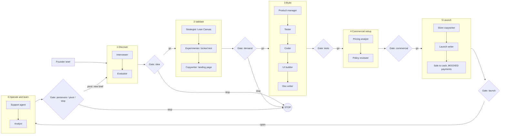
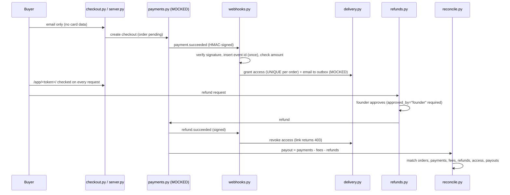
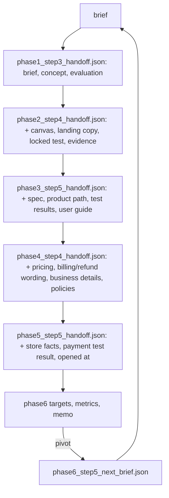

# Architecture

## Overview

sudo_win is a pipeline of six phases. Each phase is a folder with an `orchestrator.py` that runs its agents, checks their output in code, and ends in a gate. **Agents propose; code decides; the founder approves.**

- **Agents** are prompts in `prompts/`, run on a local open-weight model (gpt-oss:20b via Ollama) through an OpenAI-compatible client.
- **Code** checks every output: copy guardrails, a test sandbox, policy checks, and thresholds locked by hash before the evidence arrives. Every gate decision is made by deterministic rules.
- **The founder** approves every outward-facing step in the CLI, and can always choose a stricter path than a gate's outcome, never a looser one.

Each phase hands a JSON file in `outputs/` to the next phase. Every agent action is appended to `decision_log.json`. Phase 6 can pivot back to Phase 1 with a new brief that includes what was learned.

Shared code in `common/`:

- `llm.py`: the OpenAI-compatible client, with JSON and fenced-code modes and retries
- `decision_log.py`
- `guardrails.py`: forbidden requests, excluded categories, and copy rules
- `approval.py`: founder choices, with no defaults

`workflow.py` is the single entry point. `python workflow.py run` runs the remaining steps in order: it works out the next step from the files in `outputs/`, asks the founder before each one, and stops as soon as a step does not write its handoff (a gate said repeat, pivot or stop, or the founder stopped). It never approves anything itself; every gate and approval stays inside the phase.

## Phases

### Phase 1: Discover (`phase-1-discover/`)

- **Agents:** Interviewer (`prompts/interviewer.md`) and Evaluator (`prompts/evaluator.md`).
- **Core step, find opportunities.** The Interviewer asks 1–3 questions per round, Mom Test style (past behaviour, not opinions), until it can fill all nine parts of the concept: one-liner, problem, customer, product, value, revenue, founder fit, idea origin, and current alternatives. Following Y Combinator's "How to Get and Evaluate Startup Ideas", it digs for where the idea came from, why this founder, who already wants it, and why it doesn't exist yet. The concept counts as understood only when code confirms the model's score is at least 80/100 and every field is filled. The founder must then confirm the summary or correct it, and corrections loop back.
- **Scoring.** The Evaluator scores 8 criteria from 1 to 5 (founder-market fit, problem acuteness, customer clarity, willingness to pay, differentiation, market size, scalability, feasibility). It checks for the two YC idea mistakes (a solution in search of a problem, and tar-pit ideas), records five signals (such as "why now" and "a proxy exists"), compares 2–3 alternative angles drawn from YC's seven idea recipes, and writes 5 Mom Test interview questions.
- **Tools:** guardrails screen founder input before it reaches the model, and a separate check catches excluded product categories.
- **Output:** `phase1_step1_concept.md`, `phase1_step2_evaluation.md`, `phase1_gate_decision.md`, and `phase1_step3_handoff.json` on GO.

### Phase 2: Validate (`phase-2-validate/`)

- **Agents:** Strategist, Experimenter and Copywriter.
- **Core step, design the business.** The Strategist fills a 12-box Lean Canvas and names the three riskiest assumptions, each with a cheap test. The founder approves the canvas, edits any box, or asks for a rewrite.
- **Demand test.** The Experimenter designs a landing-page waitlist test: a hypothesis, a duration, the minimum visitors needed, a GO target and a STOP line. The code validates the plan (the STOP line must be below the target). On approval, the plan's SHA-256 hash is written to the decision log, which locks the thresholds.
- **Landing page.** The Copywriter writes plain text only. Code escapes it into a fixed template that always says the product doesn't exist yet. Drafts with fake social proof, urgency or promises are rejected before the founder sees them.
- **Tools:**
  - a local waitlist server that counts unique visitors by cookie (no IPs), with a honeypot field and duplicate-email skipping
  - a page-hash check that refuses to serve a page edited after approval
- **Output:** `phase2_step1_lean_canvas.md`, `phase2_step2_demand_test_plan.json`, `phase2_step3_landing_page.html`, `phase2_gate_demand_test.md`, and `phase2_step4_handoff.json`.

### Phase 3: Build (`phase-3-build/`)

- **Agents:** Product manager, Tester, Coder, UI builder and Doc writer.
- **Core step, build the product.**
  1. **Spec.** The Product manager writes 1–4 user stories, each with acceptance criteria that can be tested by calling one pure function in `logic.js`. If the product can't be delivered as an offline single-page web app, it says so, which leads to STOP.
  2. **Tests first.** The Tester writes `logic.test.js` from the spec only, before any code exists, with one test per criterion (`AC1: ...`).
  3. **Code against fixed tests.** The Coder writes `logic.js` and cannot change the tests. Each attempt is statically scanned, then run in the sandbox, and failures are fed back, up to N attempts. If tests still fail, the founder can keep fixing, cut the failing stories (their tests are rewritten), or stop.
  4. **Interface and guide.** The UI builder writes `index.html` on top of the tested logic, and the Doc writer writes the user guide.
- **Tools:** `sandbox.py`, which has two layers:
  - **Static scan:** rejects network calls, `eval` or `Function`, `require` or `process`, external URLs, password or card fields, and unexpected imports.
  - **Node permission model at run time:** reads limited to the build folder, no writes, network, child processes or workers, and a 30-second timeout.

  The interface's script is syntax-checked with `node --check`.
- **Output:** `phase3_step1_mvp_spec.md`, `phase3_step2_test_report.md`, `phase3_step4_user_docs.md`, `phase3_gate_tests.md`, and `phase3_step5_handoff.json`. The built product goes to `runtime/product/`, which is git-ignored generated code.

### Phase 4: Commercial setup (`phase-4-commercial-setup/`)

- **Agents:** Pricing analyst and Policy reviewer.
- **Core step, set the price and policies.**
  - **Price.** The Pricing analyst proposes one plan (one-time, monthly or yearly), a refund window and running costs, with comparisons labelled `ASSUMPTION`. Code validates the numbers, blocks fake "was $X" prices and urgency, writes the price, billing and refund wording itself, and computes break-even.
  - **Policies.** The terms, privacy and refund policies are **fixed templates filled in by code**, never written by the model. They're filled from known facts: the spec, whether waitlist emails were collected, browser-only storage, the price, and business details the founder enters. Each is marked "DRAFT, not legal advice".
  - **Checks.** Code checks run on the files on disk, so they also catch founder edits: the notice, placeholders, the contact email, matching price and refund window, renewal and cancellation terms, and the waitlist and storage disclosures.
  - **Review.** The Policy reviewer flags contradictions and topics to ask a lawyer about, and the founder acknowledges its points.
- **Output:** `phase4_step1_pricing.md`, the three `phase4_step2_*_policy.md` files, `phase4_step3_policy_review.md`, `phase4_gate_commercial.md`, and `phase4_step4_handoff.json`. **No payments of any kind.**

### Phase 5: Launch (`phase-5-launch/`)

- **Agents:** Store copywriter and Launch writer.
- **Core step, open the store.**
  - **Store page.** The Store copywriter writes the headline and FAQ only. The price, terms, features, policy links and a MOCKED-checkout notice come from approved data. The founder approves the page, and its hash is checked on every request.
  - **Launch posts.** The Launch writer drafts posts in the founder's own voice ("I built..."). Code rejects posts that impersonate a customer, contain links, or break the copy rules. The founder approves, rewrites or discards each post, and **the system never posts**.
- **Core step, deliver automatically.** The founder approves a standing delivery rule once: the email template and "deliver when a payment succeeds". From then on, a successful payment grants access automatically (see [Sale to cash](#sale-to-cash)).
- **Tools:**
  - the store server: page, MOCKED checkout, webhook endpoint, order pages, refund requests, and per-buyer access links to the product
  - the payment test run, with 9 scenarios
- **Output:** `phase5_step1_store_page.html`, `phase5_step2_launch_posts.md`, `payment_test_log.md`, `phase5_step3_payment_test.json`, `phase5_step4_reconciliation.md`, `phase5_gate_launch.md`, and `phase5_step5_handoff.json`.

### Phase 6: Operate and learn (`phase-6-operate-and-learn/`)

- **Agents:** Support agent and Analyst.
- **Targets first.** Before any results, the founder locks review targets, hash-logged. The paying-customer target defaults to Phase 4's break-even, with a stop line, a maximum refund rate, a review window and the minimum visitors needed.
- **Support.** The Support agent drafts replies grounded only in the user guide, the policies and that customer's orders. Code rejects drafts that promise refunds, features or dates, or ask for credentials. The founder approves every reply, and sending is MOCKED.
- **Metrics.** `metrics.py` computes aggregates only: visitors, conversion, paying customers, refund rate, revenue (MOCKED), break-even, waitlist-to-buyer conversion, and support categories. Product usage isn't measured, by design.
- **Memo.** The Analyst writes the persevere-or-pivot memo around the rule-based outcome, which it cannot change. It gives a verdict on each riskiest assumption, the learnings, the next experiment, pivot options, or a wind-down.
- **Output:** `phase6_step1_targets.json`, `phase6_step2_support_summary.md`, `phase6_step3_metrics.md`, `phase6_step4_memo.md`, `phase6_gate_review.md`, and `phase6_step5_next_brief.json` on a pivot, which Phase 1 accepts with `--brief`.

## Gates

Every gate is deterministic code. Model verdicts can only make an outcome **stricter**. On a failing gate the founder is never offered "approve and continue", and every gate decision is logged with `approved_by: "founder"`.

| Gate | Checks | Outcomes |
|---|---|---|
| **Phase 1 idea** (`phase-1-discover/gates.py`) | The **most severe** of: hard rules (not digital, excluded category), YC mistakes (a solution in search of a problem leads to STOP; an unaddressed tar pit leads to at most PIVOT), fixed score thresholds (any score of 1 or an average below 2.5 leads to STOP; any score below 3 or an average below 3.5 leads to PIVOT), and the model's own verdict | go, pivot (refine), **stop** (only "new idea" or "stop" offered). Repeat if the concept is still unclear after N rounds |
| **Phase 2 demand** (`phase-2-validate/gates.py`) | Evidence against the hash-locked plan: sign-ups at or above the target, the minimum visitors, the STOP line, and whether the test window is over. A plan edited after approval is refused | go; repeat (test still running, or too little traffic to judge); pivot (between the lines); **stop** (below the STOP line) |
| **Phase 3 tests** (`phase-3-build/gates.py`) | Every acceptance criterion has a passing test written before the code; no failing, skipped or to-do tests; clean scans of logic, tests and UI; a user guide that passes the copy rules | go (then the founder tries the app and approves); repeat; **stop** if it can't be built here |
| **Phase 4 commercial** (`phase-4-commercial-setup/gates.py`) | Pricing and policy checks; break-even compared with waitlist size | go; repeat (a check fails); pivot (costs not covered even if every waitlist member paid) |
| **Phase 5 launch** (`phase-5-launch/gates.py`) | Store page approved and unchanged; posts reviewed; delivery rule approved; policies present; latest payment test run passes all 9 scenarios | go (the founder opens the store); repeat |
| **Phase 6 review** (`phase-6-operate-and-learn/gates.py`) | Paying customers and refund rate against hash-locked targets; review window; traffic | persevere; repeat (window open or too few visitors); pivot (writes a new Phase 1 brief); **stop** (below the stop line after the window) |

**When the system recommends STOP on weak evidence:**

- **Phase 1:** the idea scores weakly, is a solution in search of a problem, or is an excluded product.
- **Phase 2:** sign-ups fall below the locked STOP line with enough traffic. For example, a target of 100 waitlist sign-ups in 14 days with only 12 received gives **STOP**, not a reworded success.
- **Phase 3:** the product can't be built here.
- **Phase 6:** paying customers stay below the locked stop line after the review window.

## Sale to cash

Everything below runs for real against a **MOCKED** payment provider (`phase-5-launch/payments.py`). It creates checkouts, takes a fee on a MOCKED schedule, sends HMAC-signed webhooks and makes payouts, but it doesn't contact any real or sandbox provider and no money moves.

- **Payment triggers delivery.** A signed `payment.succeeded` event marks the order paid, records the payment and fee, and grants access. All of this happens in one database transaction. Access is a secret link checked against the grant on every request.
- **A refund revokes access.** Only the founder can approve a refund. `refunds.approve` refuses anything else, and the webhook ignores refunds the founder didn't approve. The `refund.succeeded` event marks the order refunded and revokes the grant, after which the product link returns 403.
- **Idempotency prevents double delivery:**
  - each event id is inserted first, in the same transaction as its effects, so a retried event is ignored
  - `UNIQUE` constraints allow one payment and one access grant per order
  - an error rolls the whole event back, so a retry starts clean
- **Payment safety checks.** Forged signatures are rejected. Payments for the wrong amount or currency are flagged and not delivered.
- **Reconciliation** (`reconcile.py`) matches orders, payments, fees, refunds, access grants and payouts, and lists every mismatch, for example:
  - paid but not delivered
  - unpaid but has access
  - refunded but access not revoked
  - a refund total that doesn't match its payment
  - a payout that doesn't equal its payments minus fees and refunds

The 9-scenario test run (`payment_test.py`) checks all of this end to end and writes `outputs/payment_test_log.md`.

## Data flow

- **Committed (text):** `outputs/` holds each step's result, the gate decisions and the handoffs. `decision_log.json` gets one entry per agent action, with timestamp, agent, action, sources, model, cost and `approved_by`, plus token counts.
- **Git-ignored (`runtime/`, personal or generated data):**
  - waitlist emails and visit counts
  - the built product
  - the store database (orders, payments, grants, refunds, payouts, outbox, visits) and the webhook secret
  - support tickets and sent replies
- **Model calls:** they go only to the configured local endpoint, and no data leaves the machine. Founder input passes the guardrails before any model call. Everything the model produces is checked in code before it's shown, run, published or stored as an approved artifact.

## Built vs. stubbed

| Area | Built | Stubbed or mocked |
|---|---|---|
| Model | Local gpt-oss:20b through any OpenAI-compatible server | None |
| Research | Founder interviews, assumption labelling | **STUBBED**: no web research; market claims are labelled `ASSUMPTION` |
| Demand test | Landing page, waitlist server, locked gate | **STUBBED**: public hosting (local only) |
| Build | Test-first loop, sandbox, gate, single-page web apps | **STUBBED**: browser-level UI tests (the founder tries the app); other product types lead to STOP |
| Commercial | Pricing, break-even, template policies, checks | **STUBBED**: legal review (drafts marked not legal advice) |
| Payments | Checkout, signed webhooks, idempotent delivery, refunds, payouts, reconciliation | **MOCKED**: provider, cards, fees, payouts; subscription renewals **STUBBED** |
| Messaging | Founder-approved delivery and support emails | **MOCKED**: written to an outbox or folder, not sent |
| Marketing | Founder-voiced launch post drafts | **STUBBED**: posting (the founder posts) |
| Operations | Targets, metrics, support drafts, memo, pivot brief | Product usage analytics not measured (privacy by design) |

## Roadmap

1. **Sourced research.** Add a web search and fetch tool, so the Evaluator, Strategist and Pricing analyst can cite URLs instead of labelling claims `ASSUMPTION`. `sources` in the decision log is already a URL list.
2. **Founder dashboard.** A local web UI over the same orchestrators and approval functions, so non-technical founders don't need the CLI.
3. **Real payments behind the same interface.** Swap `MockPaymentProvider` for a real provider adapter, with webhooks, idempotency, refunds and reconciliation unchanged, and every charge or refund still behind founder approval.
4. **More product types.** Content products (guides, templates) with their own test strategy, and server-backed apps in a container sandbox.
5. **Evaluation set.** A library of founder briefs, including weak ones that must STOP, to measure gate accuracy and cost per run across open-weight models.
