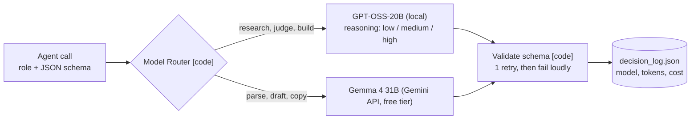
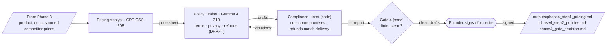
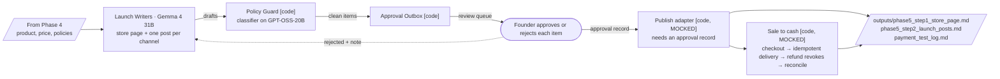
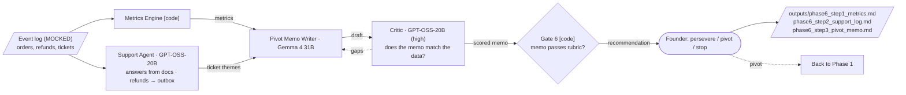

# Phase workflows

Diagrams for every phase. The text behind them is in [ARCHITECTURE.md](../ARCHITECTURE.md).

## Models and routing

GPT-OSS-20B runs locally through Ollama; Gemma 4 31B runs on Google's Gemini API free tier. No paid service, $0 per run; without a Gemini key every role runs on GPT-OSS-20B.

Full role table: [ARCHITECTURE.md · Model routing](../ARCHITECTURE.md#model-routing).

Router rules:
1. **Checker ≠ maker.** A critic or classifier never runs on the model that wrote the work.
2. **Reasoning effort per role.** GPT-OSS-20B runs at low effort to extract, medium to build, high to judge.
3. **Structured output.** Every call asks for a JSON schema, is validated, retried once, then fails loudly.
4. **Everything is logged.** Every call records the model used and its tokens in `decision_log.json`.



## Founder conversation

The Founder Liaison (Gemma 4 31B) talks with the founder throughout the run. Code decides which questions must be answered before a decision is final; the Liaison words them and handles everything else in the conversation.

```mermaid
sequenceDiagram
  actor F as Founder
  participant FL as Founder Liaison · Gemma 4 31B
  participant CL as Clarifier [code]
  participant AL as Assumption Ledger [code]
  participant DEP as Department (current phase)
  participant GK as Gatekeeper [code]

  FL->>F: Intake interview (missing fields, vague answers, motivation, limits)
  F-->>FL: Answers
  FL->>F: Read-back: "Here is what I understood… Is that right?"
  F-->>FL: Confirms / corrects
  FL->>AL: Fields confirmed; open gaps stored as ASSUMPTION
  loop Every phase
    FL->>F: Kickoff: what happens next, which assumptions it relies on, "Anything I should know?"
    F-->>FL: Optional context (founder_reported)
    DEP->>CL: Draft result + open assumptions
    CL->>CL: Sensitivity check (would another value change the result?) and contradiction check
    CL->>FL: Decision-critical questions (max 3 open)
    FL->>F: Question + why it matters
    F-->>FL: Answer
    FL->>AL: Assumption confirmed / corrected
    AL->>DEP: Re-run only the steps that depend on it
    DEP->>GK: Result
    GK->>FL: Outcome + assumptions it rests on
    FL->>F: Walk through the gate memo, answer objections
    F->>GK: Decision via gate command (never via chat)
    opt Override or rejection
      FL->>F: "What should change?"
      F-->>FL: Note, passed to the agent that redoes the work
    end
  end
  F->>FL: "Why did you…?" (any time)
  FL-->>F: Answer from dossier, ledgers and log only, with entry IDs
```

## Phases

Legend: `[code]` = plain code, no LLM · a model name = LLM agent on that model · `([Founder])` = founder action · `{Gate}` = gate · `[/file/]` = input or output.
Every call goes through the Decision Logger; every outside action goes through the Approval Outbox. Publishing, payments and the event log are MOCKED. In every phase the Founder Liaison runs the conversation shown above (kickoff, clarifying questions, gate walk-through); the diagrams below show it only where it changes the flow.

### Phase 1 · Discover — fan-out / fan-in (scatter-gather)

```mermaid
flowchart LR
  brief[/"Founder brief<br/>idea, skills, budget, time, market, values"/]
  parser["Brief Parser · Gemma 4 31B<br/>draft profile + gaps"]
  liaison["Founder Liaison · Gemma 4 31B<br/>intake interview + read-back"]
  confirm(["Founder confirms or corrects"])
  guard["Policy Guard [code]<br/>excluded product / harmful ask"]
  scout["Opportunity Scout · GPT-OSS-20B<br/>3–4 variants"]
  market["Market Researcher · GPT-OSS-20B"]
  comp["Competitor Analyst · GPT-OSS-20B"]
  ledger[("Evidence Ledger [code]<br/>id, url, snippet, fetched_at")]
  scorer["Scorer [code]<br/>fit · pain · reach · competition · buildability"]
  g1{"Gate 1 [code]<br/>≥3 pain signals, ≥2 domains,<br/>score ≥0.6, fit rules pass?"}
  rep["Gate Reporter · Gemma 4 31B<br/>go / repeat / pivot / STOP memo"]
  founder(["Founder picks a variant<br/>or accepts STOP"])
  mom["Mom Test Writer · Gemma 4 31B<br/>interview script"]
  out1[/"outputs/phase1_step1_opportunities.md<br/>phase1_step2_scores.json<br/>phase1_step3_interview_script.md<br/>phase1_gate_decision.md"/]

  brief -->|raw text| parser -->|draft profile + gaps| liaison
  liaison <-->|questions / answers| confirm
  liaison -->|confirmed profile.json| guard
  guard -->|allowed| scout
  guard -->|blocked| rep
  scout -->|variants| market & comp
  market -->|search results| ledger
  comp -->|search results| ledger
  ledger -->|evidence IDs| scorer -->|ranked variants| g1
  g1 -->|result + reasons| rep -->|memo| founder
  founder -->|chosen variant| mom --> out1
  mom --> notes(["Founder pastes interview notes<br/>or resumes without them"]) -->|founder_reported| P2["Phase 2"]
```



### Phase 2 · Validate — generator–critic debate + pre-registered experiment

```mermaid
flowchart LR
  in2[/"From Phase 1<br/>variant, evidence, interview notes"/]
  canvas["Canvas Builder · Gemma 4 31B"]
  vc["Skeptical Investor · GPT-OSS-20B (high)<br/>rubric scores + riskiest assumptions"]
  exp["Experiment Designer · GPT-OSS-20B<br/>test + target"]
  fa(["Founder approves targets"])
  lock["Threshold Lock [code]<br/>config floors · hash logged before results"]
  copy["Landing Copywriter · Gemma 4 31B"]
  lint["Policy Guard [code]<br/>classifier on GPT-OSS-20B"]
  outbox["Approval Outbox [code]<br/>publish MOCKED"]
  g2{"Gate 2 ★ [code]<br/>results vs locked targets"}
  rep2["Gate Reporter · Gemma 4 31B<br/>go / repeat / pivot / STOP"]
  out2[/"outputs/phase2_step1_lean_canvas.md<br/>phase2_step2_experiment.md<br/>phase2_step3_landing_page.html<br/>phase2_gate_decision.md"/]

  fobj(["Founder answers the toughest objections<br/>(via Founder Liaison)"])
  in2 -->|dossier slice| canvas -->|canvas v1| vc
  vc -.->|critique, max 2 rounds| canvas
  vc -.->|top objections| fobj -.->|founder_reported answers| canvas
  vc -->|canvas + risks| exp -->|proposed targets| fa -->|approved| lock
  lock -->|locked targets| copy -->|draft| lint -->|clean copy| outbox
  outbox -->|"sign-up count (founder-entered or MOCKED)"| g2
  g2 -->|pass/fail + why| rep2 --> out2
  g2 -.->|pivot| in2
```



### Phase 3 · Build — build–test loop (test-driven generation)

```mermaid
flowchart LR
  in3[/"From Phase 2<br/>approved canvas + landing promise"/]
  pm["Product Manager · GPT-OSS-20B<br/>spec + acceptance tests"]
  tpl["Template Picker [code]<br/>guide · template pack · web tool"]
  build["Builder · GPT-OSS-20B"]
  qa["QA Runner [code]"]
  docs["Docs Writer · Gemma 4 31B"]
  g3{"Gate 3 [code]<br/>all tests pass?"}
  rep3["Gate Reporter · Gemma 4 31B"]
  f3(["Founder approves MVP"])
  out3[/"outputs/phase3_step1_spec.md<br/>phase3_step2_test_report.md<br/>phase3_step3_user_guide.md<br/>phase3_gate_decision.md"/]

  in3 --> pm -->|spec + tests| tpl -->|scaffold| build -->|build| qa
  qa -.->|failures, max 3 loops| build
  qa -->|passing build| docs --> g3 -->|test report| rep3 --> f3 --> out3
```



### Phase 4 · Commercial setup — pipes and filters + linter loop



### Phase 5 · Launch — transactional outbox + human approval gate (publishing MOCKED)



### Phase 6 · Operate and learn — monitor loop (MAPE-K) + critic (events MOCKED)


