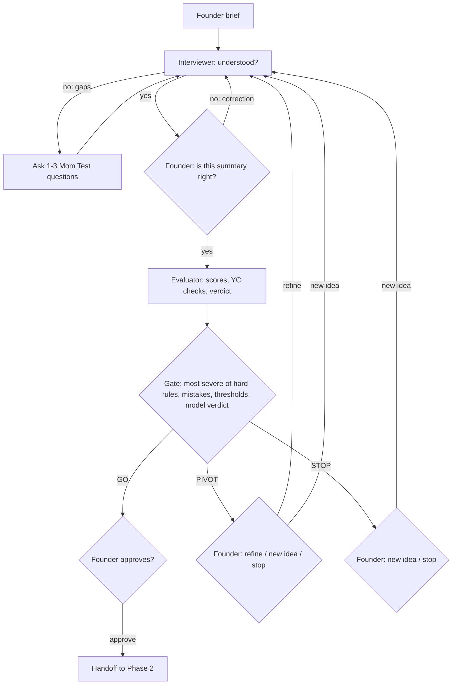

# Phase 1: Discover

Turns a founder brief into a clearly understood concept, then gives an honest **go / pivot / stop** recommendation. Runs on `gpt-oss:20b` (open-weight, local, $0 per run).

## Run

```bash
ollama pull gpt-oss:20b && ollama serve      # any OpenAI-compatible server works
python phase-1-discover/orchestrator.py                 # asks for the brief interactively
python phase-1-discover/orchestrator.py --brief b.json  # or pre-fill it (keys: idea, skills, budget, time, target_market, values)
```

Settings (env): `LLM_BASE_URL` (default `http://localhost:11434/v1`), `LLM_MODEL` (default `gpt-oss:20b`), `LLM_API_KEY`, `DISCOVER_MAX_ROUNDS` (default 8). Type `/quit` at any prompt.

## Flow



## Step 1: clarify (`agents/interviewer.py`, `prompts/interviewer.md`)

Asks questions until it understands all nine parts of the concept: problem, customer, product, value, revenue, founder fit, idea origin and current alternatives, plus a one-line summary. It counts as understood only when the model says so, its score is at least 80, and every field is filled in. The code enforces this, not only the prompt. Then the founder must confirm the summary. If they say it's wrong, their correction goes back into the loop. Following YC's advice, it digs into where the idea came from, founder-market fit, who already wants it, and why it doesn't exist yet.

## Step 2: evaluate (`agents/evaluator.py`, `prompts/evaluator.md`)

The method follows Y Combinator Startup School's [How to Get and Evaluate Startup Ideas](https://www.youtube.com/watch?v=Th8JoIan4dg), adapted for small digital-product founders:

- **8 scores (1-5):** founder-market fit, problem acuteness, customer clarity, willingness to pay, differentiation, market size, scalability, feasibility.
- **Mistake checks:** solution in search of a problem, and tar pit ideas.
- **Signals (yes/no/unclear):** the founder or people they know want it, why now, a proxy company exists, long-term interest, a good idea space.
- **Not penalised:** competitors, boring spaces, and hard-to-start ideas.
- **Alternative angles:** each comes from one of YC's 7 idea recipes.
- **Interview questions:** 5 Mom Test questions for the next step.

There is no web research in this phase, so every market claim is labelled `ASSUMPTION`.

## Gate (`gates.py`)

The thresholds are fixed in code before anything is scored. The outcome is the **most severe** of:

| Check | Result |
|---|---|
| Not digital, or an excluded category (physical goods; financial, investment or crypto; health or legal advice) | STOP |
| Solution in search of a problem | STOP |
| Tar pit with no plan for its hard part | at most PIVOT |
| Any score of 1, or an average below 2.5 | STOP |
| Any score below 3, or an average below 3.5 | PIVOT |
| The evaluator's own verdict | can make the outcome stricter, never looser |

Missing or garbled model output counts as weak, so it leads to STOP. On STOP the founder is only offered "new idea" or "stop". Approving to continue is offered only when the gate passes.

## Safety (`common/guardrails.py`, `common/approval.py`)

Founder input is checked in code before it reaches the model. Requests for fake reviews, testimonials, sign-ups or urgency, income promises, impersonation, or storing credentials are refused and logged, and are never sent to the model. Every gate decision needs an explicit founder choice, and there is no default.

## Outputs

These are written to the repo root, following the organizers' conventions:

- `outputs/phase1_step1_concept.md`
- `outputs/phase1_step2_evaluation.md`
- `outputs/phase1_gate_decision.md`
- `outputs/phase1_step3_handoff.json` (only on an approved GO)
- `decision_log.json`, one entry per agent action

## Tests

```bash
python -m unittest discover -s phase-1-discover/tests
```

The tests use a scripted fake model, so no server is needed. They cover the clarify loop, the founder correcting the summary, every gate outcome, model GO overruled by weak scores, trick prompts, quitting, and the decision-log format.
