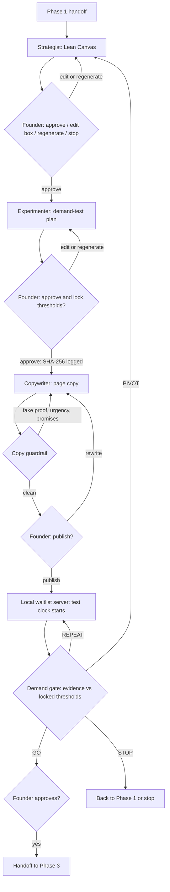

# Phase 2: Validate

Designs the business on a **Lean Canvas**, then tests demand with a **waitlist landing page** against GO and STOP thresholds that are locked before any data arrives. Runs on `gpt-oss:20b` (local, $0 per run). Starts from Phase 1's approved handoff (`outputs/phase1_step3_handoff.json`).

## Run

A demand test takes days, so this phase is three commands:

```bash
python phase-2-validate/orchestrator.py plan     # canvas -> test plan -> landing page, each approved by you
python phase-2-validate/orchestrator.py serve    # serve the approved page at http://127.0.0.1:8000
python phase-2-validate/orchestrator.py gate     # judge the evidence when the test ends
python phase-2-validate/orchestrator.py gate --signups 12 --visitors 400 --source "my host's analytics"
```

Settings are the same as Phase 1 (`LLM_BASE_URL`, `LLM_MODEL`), plus `RUNTIME_DIR` (default `runtime/`, git-ignored), `HOST` and `PORT`.

## Flow



## Steps

1. **Lean Canvas** (`agents/strategist.py`, `prompts/strategist.md`). Fills all 12 boxes in Lean Canvas order, plus the 3 riskiest assumptions and a cheap test for each. You can approve it, edit any box yourself, or have it regenerated with your feedback. Market claims are labelled `ASSUMPTION`, since this phase does no web research.
2. **Demand-test plan** (`agents/experimenter.py`, `prompts/experimenter.md`). Sets a hypothesis, a duration, the minimum number of visitors, a GO target and a STOP line, plus the channels where you would share the page yourself. The plan is checked in code: the STOP line must be below the target, and the duration must be 1–30 days. An invalid plan can't be approved. Once you approve it, its SHA-256 hash goes into `decision_log.json`, so the thresholds can't be quietly changed later.
3. **Landing page** (`agents/copywriter.py`, `landing_page.py`). The model writes only plain text, and code puts it into a fixed HTML template. All of it is escaped, and the page has no JavaScript, trackers or external files. Every draft is checked by `common/guardrails.screen_copy`. Drafts with testimonials, made-up sign-up numbers, urgency or scarcity, or promises of income are thrown away and rewritten, and never shown to you. The template always tells visitors the product doesn't exist yet and that there's nothing to buy. Publishing needs your approval, and the server refuses to serve a page that changed after you approved it.

## Demand gate (`gates.py`)

No model is involved: the gate only compares the evidence with the locked plan.

| Situation | Outcome |
|---|---|
| Sign-ups reach the target (even early) | GO, and you approve the handoff |
| Test still running and below target | REPEAT (no conclusion yet) |
| Test ended with fewer visitors than the plan's minimum | REPEAT (low traffic isn't evidence either way) |
| Sign-ups between the STOP line and the target | PIVOT (change the customer, message or offer) |
| Sign-ups below the STOP line | STOP |

The example from the problem statement is a target of 100 sign-ups with 12 received. That gives **STOP**, and the only choices offered are "back to Phase 1" or "stop". If you enter the numbers yourself with `--signups`, they're labelled founder-reported and not verified.

## What works and what is mocked

| Part | Status |
|---|---|
| Lean Canvas, test plan, copy (gpt-oss:20b) | Working |
| Plan lock and demand gate | Working |
| Local landing page and waitlist (counts unique visitors with a cookie, no IPs; skips duplicate emails; has a honeypot field to catch bots) | Working |
| Public hosting | **STUBBED**: the page runs locally. Putting it online is up to you |
| Posting to channels | **Not built**: the system suggests channels, and you post yourself |

Waitlist emails are stored in `runtime/waitlist/` and are never committed.

## Outputs

- `outputs/phase2_step1_lean_canvas.md`
- `outputs/phase2_step2_demand_test_plan.json` (the locked plan)
- `outputs/phase2_step3_landing_page.html`
- `outputs/phase2_gate_demand_test.md`
- `outputs/phase2_step4_handoff.json` (only on an approved GO)

## Tests

```bash
python -m unittest discover -s phase-2-validate/tests
```

The tests cover the approval flow, editing the canvas, invalid thresholds, rejected copy, HTML escaping, refusing an edited page, the waitlist server over real HTTP, every gate outcome, and changing the plan after approval.
