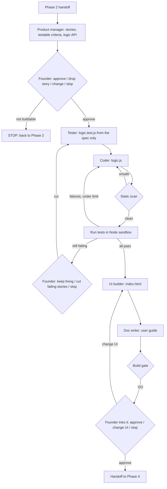

# Phase 3: Build

Turns the validated business into a **tested MVP with a user guide**. The tests are written from the spec **before** any code exists, and the gate passes only when every acceptance criterion has a passing test. Runs on `gpt-oss:20b` (local, $0 per run) and needs Node.js 22+ to run the product's tests. Starts from Phase 2's approved handoff (`outputs/phase2_step4_handoff.json`).

## Run

```bash
python phase-3-build/orchestrator.py build    # spec -> tests -> code -> interface -> guide -> gate
python phase-3-build/orchestrator.py serve    # try the MVP at http://127.0.0.1:8001 before approving
```

Settings are the same as the earlier phases, plus `BUILD_FIX_ATTEMPTS` (default 5) and `PORT`. The product is written to `runtime/product/`, which is git-ignored because it's generated code.

## What it builds

A **single-page web app** that runs in the browser:

- `logic.js` holds the app's rules as pure functions, and is tested.
- `index.html` is the interface, which calls `logic.js` and saves data in the browser.
- `logic.test.js` holds the tests.
- `README.md` is the user guide.

There is no server, account, network or payment. That form is something a 20B model can build reliably and the system can actually test. If a product's core value can't be delivered this way (for example a course, a community, or anything that needs a server), the product manager says so. The gate then returns **STOP**, with the option to go back to Phase 2.

## Flow



## Why the tests can be trusted

- **Tests come first.** The Tester sees only the spec, and every test is named after the acceptance criterion it checks (`AC1: ...`). Code checks that every criterion has a test. The Coder gets the tests but can't change them, and when they fail it gets the failure output back to fix the code.
- **No dodging.** Skipped or to-do tests count as a failure. Tests can't use the clock, random values or timers.
- **The founder controls scope.** If a story can't be made to pass, you can cut it. Its tests are then rewritten for the smaller spec, and the cut is recorded in the spec's "out of scope" list.

## Sandbox (`sandbox.py`)

Model-written code is checked twice:

1. **Static scan before anything runs.** It rejects network calls, `eval` or `Function`, `require` or `process`, dynamic imports, external URLs, password or card fields, forms that submit anywhere, and unexpected imports. `logic.js` must be pure: no storage, DOM, clock or randomness. A file that fails is sent back with the exact problems.
2. **Node's permission system at run time.** File reads are limited to the build folder. There are no writes, network, child processes, workers or addons, and there's a 30-second timeout. The tests check this against a live local server.

The interface's script is syntax-checked with `node --check`. Its text goes through the same copy rules as the landing page, so it can't contain testimonials, user counts, urgency or promises.

## Build gate (`gates.py`)

The gate is deterministic. **GO** needs all of the following:

- every acceptance criterion has a passing test
- no failing, skipped or to-do tests
- clean scans of `logic.js`, `logic.test.js` and `index.html`
- a user guide that passes the copy rules

Even after GO, you have to try the app and approve it before the handoff is written. A product that can't be built here gets **STOP**.

## What works and what is mocked

| Part | Status |
|---|---|
| Spec, tests, code, interface, guide (gpt-oss:20b) | Working |
| Test-first loop with failure feedback, sandbox, gate | Working |
| Interface behaviour in a real browser | **Not automatically tested**: only syntax and safety are checked, so you try it before approving |
| Products that need a server, accounts, or are not software | **Not supported**: the gate returns STOP |

## Outputs

- `outputs/phase3_step1_mvp_spec.md`
- `outputs/phase3_step2_test_report.md`
- `outputs/phase3_step4_user_docs.md`
- `outputs/phase3_gate_tests.md`
- `outputs/phase3_step5_handoff.json` (only after you approve)

## Tests

```bash
python -m unittest discover -s phase-3-build/tests
```

The tests use a scripted fake model, but the sandbox and the Node test runner are real. They cover:

- the happy path, and stopping at the gate
- feeding failures back to the Coder, and cutting a failing story
- rejecting unsafe code, test files and interface code
- STOP for a product that can't be built
- the permission system against a live server, and timeouts
- skipped tests counting as failures
- the static scans and spec validation
