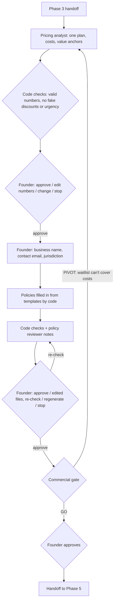

# Phase 4: Commercial setup

Sets the **price** and drafts the **terms of service, privacy policy and refund policy**. **No payments of any kind** are set up. Runs on `gpt-oss:20b` (local, $0 per run). Starts from Phase 3's approved handoff (`outputs/phase3_step5_handoff.json`).

## Run

```bash
python phase-4-commercial-setup/orchestrator.py
```

The settings are the same as the earlier phases.

## Flow



## Step 1: pricing (`agents/pricing_analyst.py`, `pricing.py`)

The pricing analyst proposes one paid plan: one-time, monthly or yearly. The proposal includes:

- the price, the refund window and the monthly running costs
- what the customer uses today
- an honest way to test the price before charging

Competitor prices and costs are labelled `ASSUMPTION`. Code then:

- **checks the numbers**
- **rejects pricing copy** with fake "was $X" prices, percent-off claims, urgency or promises
- **works out break-even** (how many paying customers cover the running costs)

The price line ("$19 per month"), the renewal and cancellation note, and the refund note are **written by code, not the model**. That way, how often customers are charged and how to cancel can't be left out or reworded. You can approve the plan, edit any number, or ask for changes.

## Steps 2-3: policies (`policies.py`, `agents/policy_reviewer.py`)

Legal text from a 20B model is risky, so **the model never writes the policies.** They come from fixed, plain-language templates that code fills in from facts the system already knows:

- **from the MVP spec:** what the product does and doesn't do
- **from Phase 2:** whether waitlist emails were collected
- **from Phase 3:** that data stays in the browser
- **from Step 1:** the approved price, billing and refund window
- **from you:** your business name, contact email and jurisdiction

Every draft starts with **"DRAFT. This is not legal advice"** and a note to have a lawyer in your jurisdiction review it. The policies also say plainly that payments aren't taken yet, that card details will never be stored, and that refunds are always approved by a person.

**Code checks** run on the files as they are on disk, so they also catch problems you introduce while editing:

- the notice is still there
- no leftover placeholders like `[BUSINESS NAME]`
- the contact email is in every document
- the price matches what you approved
- a subscription has renewal and cancellation terms
- the refund window is the same everywhere
- the privacy policy explains waitlist emails and browser storage

The **policy reviewer** (gpt-oss) reads the drafts against the facts. It flags contradictions, gaps and topics to ask a lawyer about, but it doesn't rewrite anything. Its points don't decide the gate. If it asks for fixes, the approve option says you've read them, and that acknowledgement is logged per policy.

You can edit the draft files in `outputs/`, then choose "check again". Policies can't be approved while a code check fails.

## Gate (`gates.py`)

| Situation | Outcome |
|---|---|
| A pricing or policy check fails | REPEAT |
| Break-even needs more paying customers than joined the waitlist (costs aren't covered even if every sign-up paid) | PIVOT: change the price or costs, or go back to Phase 2 |
| Otherwise | GO, which you must approve |

## What works and what is mocked

| Part | Status |
|---|---|
| Pricing proposal, checks, break-even | Working |
| Policy drafts from templates, code checks, model review | Working |
| Legal review | **Not provided**: drafts are marked as not legal advice, and a lawyer must review them |
| Payments | **Not set up**: no payment provider, no sandbox, no charges |

## Outputs

- `outputs/phase4_step1_pricing.md`
- `outputs/phase4_step2_terms_of_service.md`
- `outputs/phase4_step2_privacy_policy.md`
- `outputs/phase4_step2_refund_policy.md`
- `outputs/phase4_step3_policy_review.md`
- `outputs/phase4_gate_commercial.md`
- `outputs/phase4_step4_handoff.json` (only after you approve)

## Tests

```bash
python -m unittest discover -s phase-4-commercial-setup/tests
```

The tests cover:

- the happy path
- your edits being re-checked (removed notice, placeholder text) and regenerating the drafts
- fake discounts being blocked
- a price the waitlist can't cover leading to PIVOT, then repricing
- one-time payments with no refunds
- re-asking for an invalid email
- acknowledging the reviewer's points
- refusing trick prompts
- the pricing maths and the gate rules
