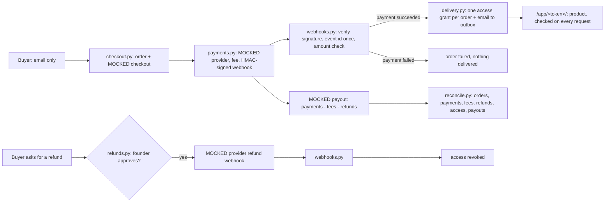

# Phase 5: Launch

Opens the store and delivers the product automatically. It writes the store page and launch posts, and runs the full **sale-to-cash** loop. **Payments are MOCKED:** there's no payment provider (not even a sandbox), no card details, and no money moves. Runs on `gpt-oss:20b` (local, $0 per run). Starts from Phase 4's approved handoff (`outputs/phase4_step4_handoff.json`) and Phase 3's product.

## Run

```bash
python phase-5-launch/orchestrator.py prepare    # store page, launch posts, delivery rule: each approved by you
python phase-5-launch/orchestrator.py test-run   # payment + delivery test (MOCKED) -> outputs/payment_test_log.md
python phase-5-launch/orchestrator.py gate       # all approved + test passed -> you open the store
python phase-5-launch/orchestrator.py serve      # the store at http://127.0.0.1:8002
python phase-5-launch/orchestrator.py refunds    # you approve or deny each refund request
python phase-5-launch/orchestrator.py reconcile  # match orders, payments, fees, refunds, access, payouts
```

## Preparing the launch (`prepare`)

1. **Store page** (`agents/writers.py`, `store_page.py`). The model writes only the headline, subheadline, "who it's for" and FAQ. Code places them into a fixed template. Everything else on the page comes from approved data, not the model:
   - the price, billing and refund lines (from Phase 4)
   - the feature list and the "not included yet" list (from Phase 3's spec)
   - links to the policies
   - a **MOCKED CHECKOUT** notice

   Drafts with testimonials, user counts, urgency, discounts, promises or links are rejected and rewritten. You approve the page before it's published locally, and the server refuses to serve a page that changed after approval.
2. **Launch posts.** The model drafts 2–4 posts, one per channel, for **you to post yourself, under your own name**. Code rejects a post if:
   - it doesn't say you built the product
   - it's written as a customer or bystander
   - it contains links, other than a `{store_link}` placeholder
   - it breaks the copy rules

   You approve, rewrite (your text is checked too) or discard each post. **The system never posts, schedules or sends anything.**
3. **Delivery rule.** You approve, once, the delivery email and the rule "when a payment succeeds, grant access and send this email." That's the standing approval that makes delivery automatic. If the email template changes, the approval is void. Refunds still need you every time.

## Sale to cash



- **Payment triggers delivery.** A signed `payment.succeeded` webhook marks the order paid, records the payment and fee, and grants access. All of this happens in one database transaction. Access is a private link that the store checks on every request.
- **Idempotency.** The webhook's event id is stored first, in the same transaction as its effects. Database constraints allow one payment and one access grant per order. A retried webhook therefore can't deliver twice, and an error rolls everything back.
- **Safety checks on payments.** Webhooks with a bad signature are rejected. A payment for the wrong amount or currency is flagged and nothing is delivered.
- **A refund revokes access.** Buyers can request a refund from their order page. Only the founder can approve it: `approve(..., approved_by="founder")` refuses anything else, and the webhook ignores refunds the founder didn't approve. The refund webhook then revokes access, and the product link returns 403.
- **Reconciliation** checks that:
  - every paid order has exactly one payment of the right amount and was delivered
  - unpaid orders have no access
  - refunded orders lost access
  - recorded refunds match payments
  - each payout equals its payments minus fees and refunds

## Payment test run (`test-run`, `payment_test.py`)

This runs the real store code on a throwaway database, with product access checked over real HTTP. The results are written to `outputs/payment_test_log.md`. The 9 scenarios are:

1. a payment triggers delivery
2. a duplicate webhook doesn't deliver twice
3. a forged webhook is rejected
4. a failed payment delivers nothing
5. a payment for the wrong amount isn't delivered
6. a refund without the founder is refused
7. an approved refund revokes access
8. the payout matches payments minus fees and refunds
9. reconciliation catches a deliberately broken record

## Gate (`gates.py`)

**GO** requires all of the following:

- the store page is approved and unchanged
- the launch posts have been reviewed
- the delivery rule is approved
- the policies are present
- the latest test run passed every scenario

You then choose whether to open the store, which writes the handoff to Phase 6.

## What works and what is mocked

| Part | Status |
|---|---|
| Store page, launch posts (gpt-oss:20b), approvals | Working |
| Checkout, webhooks, idempotent delivery, refund revokes access, payouts, reconciliation | Working, against a **MOCKED** payment provider |
| Payment provider, card payments, fees, payouts | **MOCKED**: no provider, no sandbox, no money |
| Delivery email | **MOCKED**: written to the outbox table and shown on the order page, not sent |
| Posting launch posts | **Not built on purpose**: you post them yourself |
| Public hosting | **STUBBED**: the store runs locally |
| Subscription renewals | **STUBBED**: only the first payment is simulated |

Buyer emails and the webhook secret live in `runtime/store/`, which is git-ignored.

## Outputs

- `outputs/phase5_step1_store_page.html`
- `outputs/phase5_step2_launch_posts.md`
- `outputs/payment_test_log.md`
- `outputs/phase5_step3_payment_test.json`
- `outputs/phase5_step4_reconciliation.md`
- `outputs/phase5_gate_launch.md`
- `outputs/phase5_step5_handoff.json` (when you open the store)

## Tests

```bash
python -m unittest discover -s phase-5-launch/tests
```

The tests cover:

- the approvals in `prepare`, and rejection of dishonest copy and fake-voice posts
- checks on your own edits to posts
- all 9 test-run scenarios, and the gate before and after the test run
- a store page edited after approval
- buying, opening, refunding and revoking over real HTTP
- path traversal attempts
- bad webhook signatures and duplicate webhooks
- refunds needing a matching email and the founder
