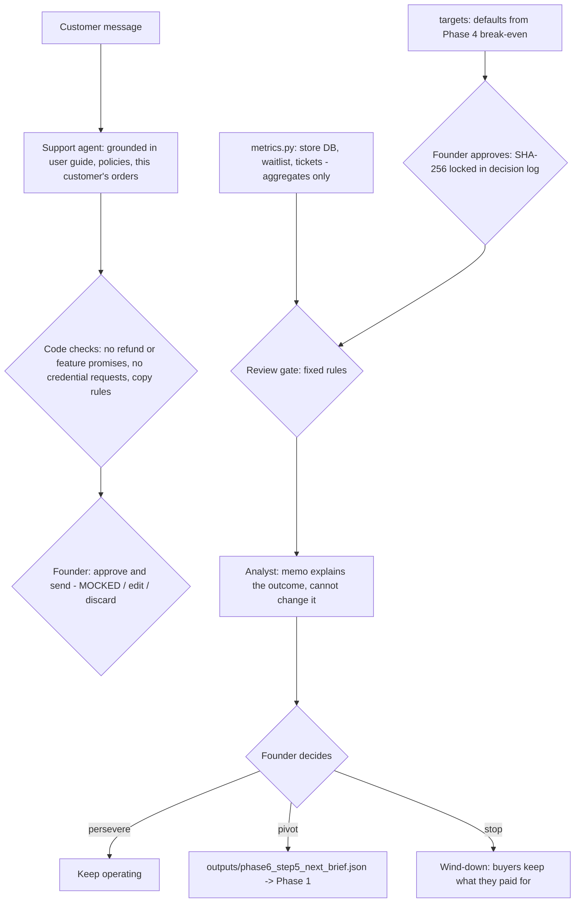

# Phase 6: Operate and learn

Supports customers, measures the business, and decides whether to **persevere, pivot or stop**. The decision comes from targets you lock **before** the results come in. A pivot writes a new brief for Phase 1, which closes the loop. Runs on `gpt-oss:20b` (local, $0 per run). Starts from Phase 5's handoff (`outputs/phase5_step5_handoff.json`) and reads the live store's database.

## Run

```bash
python phase-6-operate-and-learn/orchestrator.py targets   # Step 1: lock review targets (do this at launch)
python phase-6-operate-and-learn/orchestrator.py support --email buyer@example.com --message "..."   # Step 2
python phase-6-operate-and-learn/orchestrator.py metrics   # Step 3
python phase-6-operate-and-learn/orchestrator.py review    # Step 4: gate + memo + your decision
```

## Flow



## Step 1: targets (`gates.py`)

Before looking at any results, you approve:

- a review window (default 30 days)
- a paying-customer **target**, which defaults to Phase 4's break-even, so "success" means the business at least covers its costs
- a **stop line**, which defaults to half the target
- a maximum refund rate (default 20%)
- the minimum number of store visitors needed to judge

The targets are checked, then their SHA-256 hash goes into `decision_log.json`. The review refuses to run if they were changed afterwards.

## Step 2: support (`support.py`, `agents/support_agent.py`)

You paste a customer message, optionally with their email. The support agent drafts a reply using **only**:

- the Phase 3 user guide
- the Phase 4 policies
- the product facts
- this customer's own orders, looked up by email

If the answer isn't in there, it says it will check. Code rejects any draft that does one of these:

- says a refund was or will be made (a person reviews every refund)
- promises features or dates
- asks for passwords or card details
- breaks the copy rules

Rejected drafts are rewritten automatically. Your own edits get the same checks. Approved replies are **"sent" MOCKED**: saved to `runtime/support/sent/`, not emailed. Customer messages stay in the git-ignored `runtime/`. The summary in `outputs/` has emails and phone numbers removed.

## Step 3: metrics (`metrics.py`)

All metrics are computed by code:

- **Store:** visitors (unique browsers, counted with a cookie, no IPs), checkouts started, paying customers, refunds, failed payments
- **Rates:** visit-to-purchase, checkout completion, refund rate
- **Money:** gross, fees, refunds, net, monthly recurring revenue (all MOCKED), compared with break-even
- **Waitlist:** how many waitlist members bought
- **Support:** tickets by category

Only totals and rates leave the module. **Product usage is not measured**, because the app keeps data in the user's browser and has no analytics, by design. The metrics file says so.

## Step 4: review gate and memo

| Situation | Outcome |
|---|---|
| Paying customers at or above the target, refund rate within the limit | PERSEVERE |
| Review window still open | REPEAT (no verdict yet) |
| Too few store visitors to judge | REPEAT (low traffic isn't evidence) |
| Refund rate too high | PIVOT if paying customers are at or above the stop line, else STOP |
| Paying customers between the stop line and the target | PIVOT |
| Below the stop line | STOP |

The **analyst** (gpt-oss) is given the fixed outcome and writes the memo around it. The memo covers:

- what happened, using only the given numbers
- a verdict on each riskiest assumption from the Lean Canvas (confirmed, refuted or untested), with evidence
- what was learned, and themes from support
- the next experiment if you persevere
- 2–3 options if you pivot
- a respectful wind-down if you stop

Its prompt says it can't change the outcome, and the memo file always leads with the outcome from the rules.

**Your decision** can be stricter than the outcome, but never looser. On STOP, "persevere" isn't offered.

- **Pivot:** you pick an option or describe a new direction. That writes `outputs/phase6_step5_next_brief.json`, which contains the original brief plus the new direction and what was learned. Run Phase 1 again with `python phase-1-discover/orchestrator.py --brief outputs/phase6_step5_next_brief.json`.
- **Stop:** existing buyers keep what they paid for, refunds follow the policy and need your approval, and nothing is sent or refunded automatically.

## What works and what is mocked

| Part | Status |
|---|---|
| Targets lock, metrics, review gate | Working |
| Support drafts and memo (gpt-oss:20b) with code checks | Working |
| Sending support replies | **MOCKED**: saved, not emailed |
| Revenue figures | **MOCKED**: they come from Phase 5's mocked payments |
| Product usage analytics | **Not measured**, by design (privacy) |
| Closing the store automatically on STOP | **Not built**: the wind-down steps are for you to carry out |

## Outputs

- `outputs/phase6_step1_targets.json`
- `outputs/phase6_step2_support_summary.md`
- `outputs/phase6_step3_metrics.md`
- `outputs/phase6_step4_memo.md`
- `outputs/phase6_gate_review.md`
- `outputs/phase6_step5_next_brief.json` (on a pivot)

## Tests

```bash
python -m unittest discover -s phase-6-operate-and-learn/tests
```

The tests use Phase 5's real database schema. They cover:

- **Targets:** defaults taken from break-even, invalid targets that can't be approved, and targets moved after approval being refused
- **Review outcomes:** persevere, stop (with no way to persevere), pivot (writing a Phase 1 brief), repeat while the window is open or traffic is low, and a high refund rate
- **The analyst** being unable to change the outcome
- **Support:** grounding in the customer's own orders, mocked sending, and personal details removed from summaries
- **Support checks:** a reply promising a refund is rewritten, your own edits are checked, and a discarded reply is never sent
- **Metrics:** aggregates only
