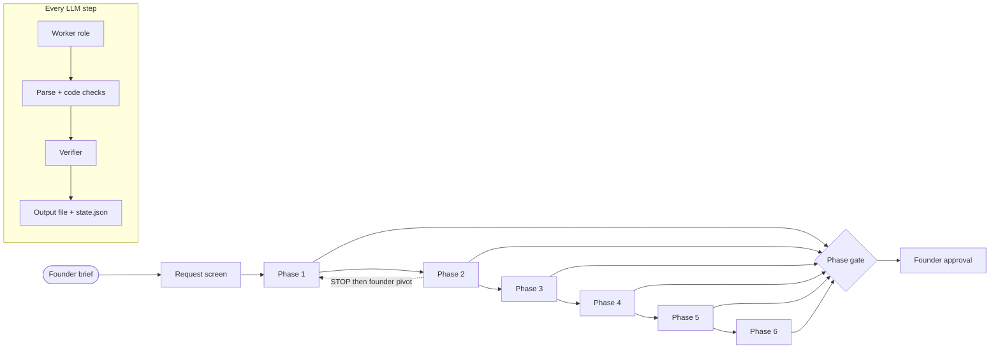

# Variant: _template (baseline)

## Idea in one sentence

Hub-and-spoke: the orchestrator runs each phase in waves (independent steps in parallel across the GPU endpoints), one model call per LLM step (one per feature for the MVP), shared code checks after each step, one gate per phase.

## Agent roster

| role | phases | reads | writes | model |
|---|---|---|---|---|
| intake | 1 | founder brief | phase1_step1 brief | gpt-oss-20b |
| researcher | 1 | brief, fetched sources | phase1_step2 opportunities, phase1_step4 market | gpt-oss-20b |
| analyst | 1, 2, 4, 6 | brief, opportunities, market, canvas, gate metrics | phase1_step3, phase1_step5, phase2_step1, phase2_step3, phase4_step1, phase6_step3 | gpt-oss-20b |
| builder | 3 | canvas, spec | phase3_step1 mvp-spec, phase3_step2 mvp (one call per feature), phase3_step3 user-docs | gpt-oss-20b |
| marketer | 2, 5, 6 | canvas, pricing, spec, docs | phase2_step2 landing-page, phase5_step1 store-page, phase5_step2 launch-posts, phase6_step1 support | gpt-oss-20b |
| verifier | all | one request, claim or outward text | none (verdicts in the log) | gpt-oss-20b |

## Flow

## Gates and approvals

- Step gates: [T] phase1_step2, phase1_step4, phase2_step4, phase4_step1; [X] every other step (schema, provenance, truncation, guardrails, tests).
- Phase gates: deterministic rules in gates.py recommend go/repeat/pivot/stop; [F] the founder accepts or overrides each one.
- ✋ Outward actions (MOCKED, outbox only, each at most once): send_outreach (1.5), publish_landing_page (2.2), open_store (5.1), publish_posts (5.2), refund (5.4), send_support_replies (6.1).

## How it differs from baseline

This is the baseline.

## Known weaknesses

- Parallelism inside one idea is limited (waves of 1-3 steps); run several ideas at once to keep both GPUs busy.
- Provenance proves a URL was fetched, not that it is relevant; only the verifier checks support.
- The verifier uses the same model as the workers, so it shares their blind spots.
- A "repeat" re-runs the whole phase (outward actions already done are not repeated).
