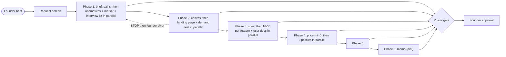

# Variant: anan (tuned baseline for gpt-oss-20b)

## Idea in one sentence

The template's hub-and-spoke roles, tuned for a small open-weight model on 16 GB GPUs: shorter prompts with an explicit answer shape, narrower inputs per step (so more steps run in parallel), word limits that keep answers clear of truncation, and honest context hints where the model is most tempted to invent.

## Agent roster

| role | phases | reads | writes | model |
|---|---|---|---|---|
| intake | 1 | founder brief | phase1_step1 brief | gpt-oss-20b |
| researcher | 1 | brief, pains, sources (queries name the market) | phase1_step2 opportunities, phase1_step4 market | gpt-oss-20b |
| analyst | 1, 2, 4, 6 | brief + pains (interview kit), pains + market (canvas), canvas (demand test), market + spec (price), gate metrics (memo) | phase1_step3, phase1_step5, phase2_step1, phase2_step3, phase4_step1, phase6_step3 | gpt-oss-20b |
| builder | 3 | canvas + brief (spec), spec (MVP per feature, user docs) | phase3_step1 mvp-spec, phase3_step2 mvp, phase3_step3 user-docs | gpt-oss-20b |
| marketer | 2, 5, 6 | canvas, pricing, spec, docs | phase2_step2 landing-page, phase5_step1 store-page, phase5_step2 launch-posts, phase6_step1 support | gpt-oss-20b |
| verifier | all | one request, claim or outward text | none (verdicts in the log) | gpt-oss-20b |

## Flow

## Gates and approvals

- Same as the baseline: step gates [T] phase1_step2, phase1_step4, phase2_step4, phase4_step1 and [X] everywhere else; phase gates from gates.py recommend, [F] the founder decides with the stage review (revise / redo at gates 1-4, reset at gate 5, go / pivot / stop everywhere; max 3 retries per phase).
- ✋ Outward actions (MOCKED, outbox only, once per content; changed content needs a new approval and supersedes the old item): send_outreach (1.5), publish_landing_page (2.2), open_store (5.1), publish_posts (5.2), refund (5.4), send_support_replies (6.1).

## How it differs from baseline

- Prompts: numbered rules, an example answer shape, word limits per content type; `evidence_gaps` field for researcher and analyst.
- Context: interview kit reads the pains (not competitors), canvas skips alternatives, demand test skips the landing page, pricing skips the canvas, user docs read only the spec. Result: 17 waves instead of 20.
- Budgets: 4000/1800 tokens (builder 4500/2800, verifier 2000/400) instead of 5000/2000; digest 600 characters.
- Hints (`HINTS`, added to every attempt): price must come from sourced competitor prices; the memo is told there are no real customers yet.
- Sampling: workers use gpt-oss's recommended temperature 1.0 / top_p 1.0; the verifier uses temperature 0.5.
- Researcher queries include the target market.

## Known weaknesses

- User docs are written from the spec, not the MVP text, so they can drift from what the MVP says.
- Smaller budgets can trim sources on long phases; a trimmed prompt is counted (`trimmed_prompts`) but not shown in the outputs.
- Same model for workers and verifier: shared blind spots.
- Tuned against fake endpoints only so far; word limits and budgets need checking on real gpt-oss-20b runs.
